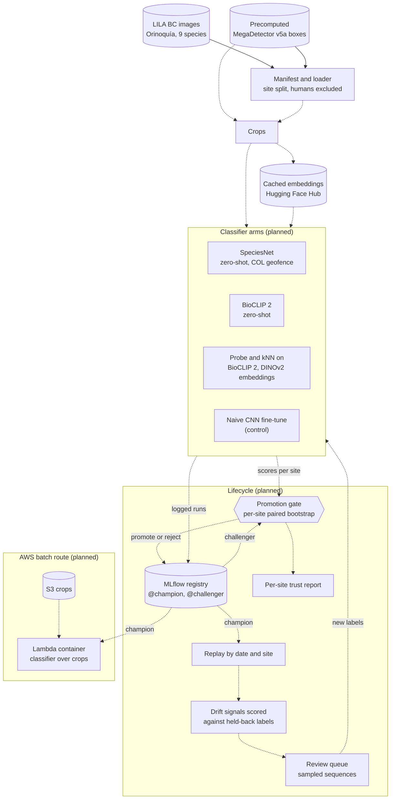

# Camera-Trap MLOps

Status: scaffold, manifest and image fetch built (site splits frozen); the first spike is next.

## The question

Can a small, reproducible lifecycle decide, site by site, whether to
trust a zero-shot camera-trap species classifier or replace it with an
adapted one, and can it tell from unlabelled images when that decision
needs revisiting?

Strong off-the-shelf classifiers already exist (SpeciesNet, BioCLIP 2).
What is rarely published is the accountability around them: how well
they do at camera sites they were never trained on, when an adapted
model has earned the right to replace them, and whether any label-free
signal warns that accuracy has dropped. This project builds that
layer. Finding that the off-the-shelf model should stay in place
everywhere would still be a complete result.

## How it works

The components are below. Solid parts are built; dashed parts are
planned, and the diagram is updated as each one lands.



## Data

Orinoquía Camera Traps (Vélez et al. 2023), from
[LILA BC](https://lila.science/datasets/orinoquia-camera-traps/),
released under the
[Community Data License Agreement (permissive)](https://cdla.io/permissive-1-0/).
Images are fetched from LILA's public mirrors and are not stored in this
repository.

The committed manifest, [`data/manifest/orinoquia.csv`](data/manifest/orinoquia.csv),
lists one row per image in a clean single-species sequence of the nine
classes: 65,042 images in 9,451 sequences at 49 sites. It is built from
LILA's metadata and precomputed MegaDetector v5a results, whose URLs and
SHA-256 checksums are recorded in
[`data/manifest/orinoquia.json`](data/manifest/orinoquia.json) along with
the counts of everything dropped. Any sequence that ever showed a person
is dropped whole (those images were removed upstream), as are
multi-species sequences and sequences of other classes.

Splits are by site, never by image. Ten sites with at least 30 sequences
each form the final hold-out, drawn with a fixed seed so that every class
has at least 15 hold-out sequences at two or more sites; the other 39
sites form five grouped folds of about 1,530 sequences each. The draw
uses label counts only, never model scores, and its hash is checked by
the tests so the hold-out cannot move after the freeze.

The first spike uses a smaller selection,
[`data/manifest/orinoquia_spike.csv`](data/manifest/orinoquia_spike.csv),
drawn from the fold sites only, so no hold-out image is downloaded before
the freeze. It holds up to 100 sequences per class per site, keeping in
each the three frames with the most confident MegaDetector animal box
(14,806 images), plus 500 random fold images of any confidence for
checking the precomputed detections against a fresh run. `make fetch`
downloads them (about 11 GB) and writes each image's SHA-256 into the
manifest, so a later download can be checked against it.

## Reproducing

Needs [uv](https://docs.astral.sh/uv/) and nothing else: no accounts or
API keys. Python 3.14 on Linux x86-64 or Apple-silicon macOS.

```bash
make install          # core and dev tools: gate, drift, tracking, tests
make install-models   # adds CPU torch, BioCLIP 2, DINOv2 and SpeciesNet
source venv/bin/activate
make test lint format-check
make manifest         # optional: rebuild the manifest from LILA (5 MB download)
make fetch            # optional: download the spike's images (11 GB) and check them
```

`make help` lists every target.

## Licence

Code: [MIT](LICENSE). Data keep their own licences (see Data).
