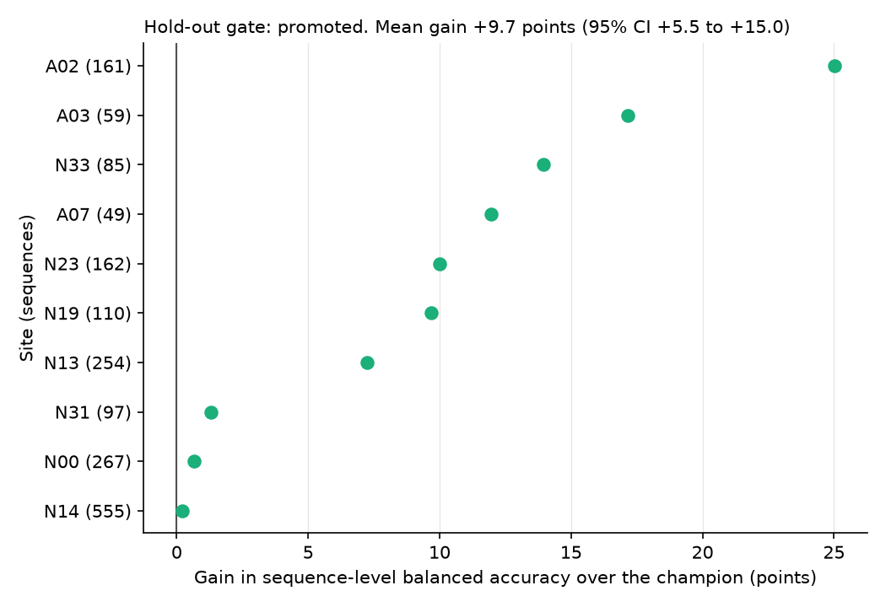
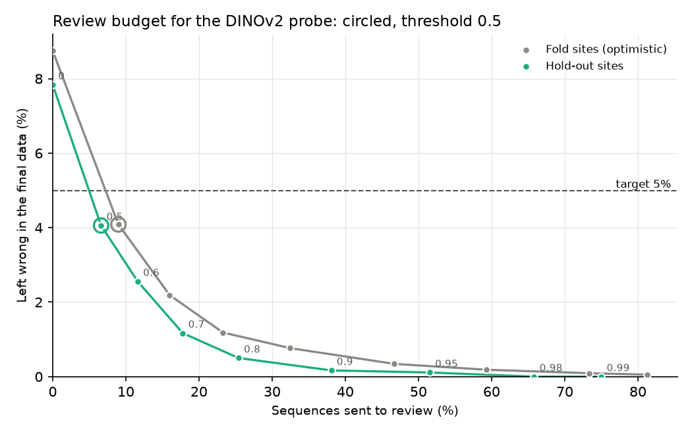
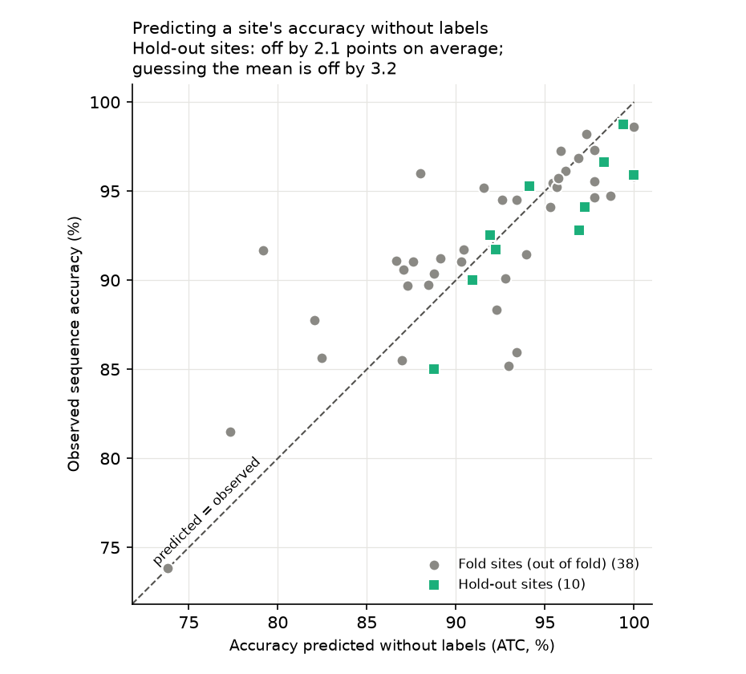
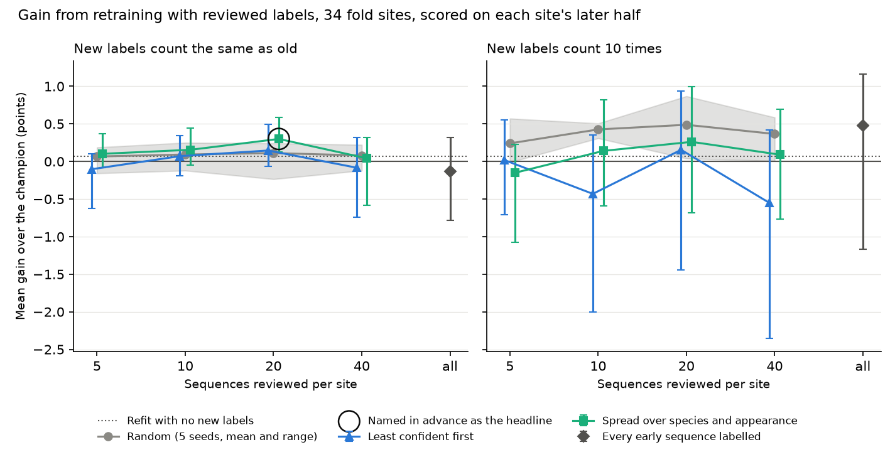
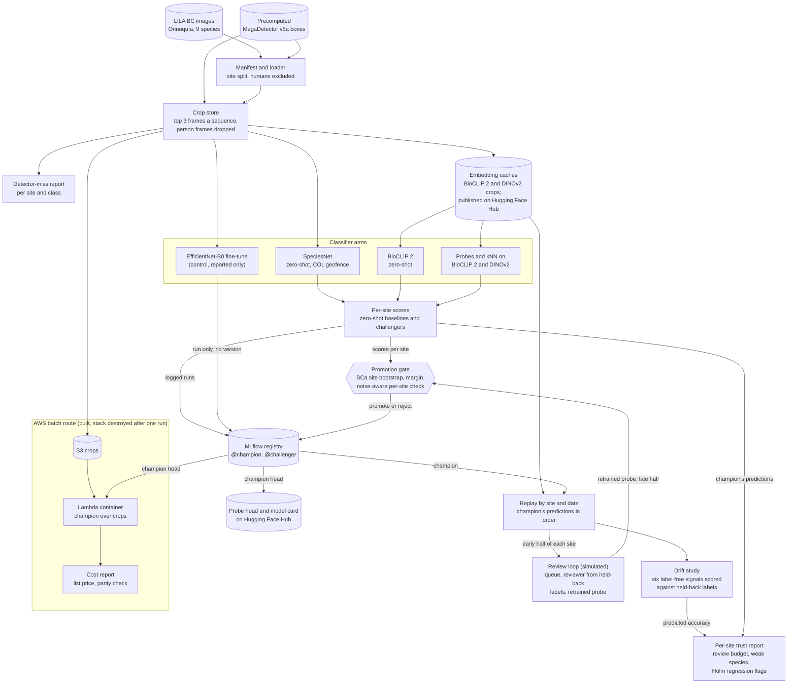

# Camera-Trap MLOps

**Status: complete.** A promotion gate, a per-site trust report, a drift
study, a simulated review loop and a measured cloud route, built around
off-the-shelf camera-trap species classifiers. On ten camera sites held back
until the test was fixed, a small trained classifier beat the off-the-shelf
model at all ten. The checks built to watch it afterwards gave mostly
modest or negative results, and those are reported as they fell.



## The question

Can a small, reproducible lifecycle decide, site by site, whether to
trust a zero-shot camera-trap species classifier or replace it with an
adapted one, and can it tell from unlabelled images when that decision
needs revisiting?

Strong off-the-shelf classifiers already exist (SpeciesNet, BioCLIP 2).
What is rarely published is the accountability around them: how well
they do at camera sites they were never trained on, when an adapted
model has earned the right to replace them, and whether any label-free
signal warns that accuracy has dropped. This project builds that
layer. Finding that the off-the-shelf model should stay in place
everywhere would still be a complete result.

## Results

Scores are balanced accuracy per camera site, at sequence level: recall
averaged over the species present at a site, with one answer per burst of
frames. Each row links to the full write-up.

| Question | Answer | Detail |
| --- | --- | --- |
| How good is an off-the-shelf model at sites it never trained on? | BioCLIP 2 zero-shot averages 0.83 over 38 sites, and 21 of them fall below 0.85. Its main fault is confusing the two peccaries. | [Baselines](docs/baselines.md) |
| Do cheap adapted models do better? | Yes. A linear probe or kNN on frozen embeddings gains 5 to 7 points on sites it was not trained on. | [Challengers](docs/challengers.md) |
| Does the best of them earn promotion on sites nobody had looked at? | **Yes.** The DINOv2 probe scores 0.933 against 0.836, a gain of 9.7 points (95% interval 5.5 to 15.0), ahead at all ten held-out sites. The test was fixed and hashed first and run once. | [Hold-out](docs/holdout.md), [gate](docs/gate.md) |
| Would fine-tuning a whole CNN beat it? | No. An EfficientNet-B0 control beats zero-shot (0.885) but not the probe (0.900), after 14 hours of training against the probe's seconds. | [CNN control](docs/cnn-control.md) |
| How much human review does the champion need? | Sending answers under 50% confidence to a person means reviewing 6.6% of held-out sequences and leaves 4.1% wrong, against 7.8% with no review. | [Trust report](docs/trust-report.md) |
| Can accuracy at a new site be read off unlabelled images? | Barely. The model's confidence ranks sites by accuracy (rank correlation 0.76), but predicts a site's accuracy only 1.1 points better than guessing the average, and that margin could be zero. Distance from the training images says nothing. | [Drift study](docs/drift-study.md) |
| Does labelling a few sequences at a new site and retraining help? | No. Twenty labelled sequences a site moved accuracy by 0.3 points, and the gate cannot tell that from a refit with no new labels. | [Review loop](docs/review-loop.md) |
| What does it cost to run in the cloud? | $0.267 per 10,000 crops on AWS Lambda at list price, measured over all 25,947 crops, with the same answers as the local model. | [AWS batch route](docs/aws-batch-route.md) |

**Review budget.** Each point is a confidence threshold: how much goes to a
person against how much is left wrong.



**Accuracy predicted without labels.** Sites differ little, so the
prediction adds little to the average.



**Retraining on reviewed sequences.** The gain stays under a point whatever
the queue or the number of labels.



The promoted model is published with a model card at
[benmacp123/orinoquia-dinov2-probe](https://huggingface.co/benmacp123/orinoquia-dinov2-probe);
`make head-check` confirms it is byte for byte the head the hold-out run wrote.

## Limitations

- **One dataset, one study area, seven months.** The held-out sites are new
  cameras in the same region of Colombia. Nothing here tests a new region, a
  new season or a change of camera.
- **The pretrained models may have seen these images.** SpeciesNet probably
  has: Orinoquía was reviewed on Wildlife Insights, which supplies its
  training data. Its scores are shown for reference, never as held-out
  performance, and it takes no part in the gate. BioCLIP 2's and DINOv2's
  training sources could not be checked in full. Any such exposure flatters
  the zero-shot baseline, which makes the probe's win conservative, but the
  probe sits on embeddings that carry the same risk.
- **A clean subset, not a deployment stream.** Nine species, single-species
  sequences only, no empty frames. Accuracy on everything a camera records
  would be lower.
- **The detector is upstream and unscored.** MegaDetector finds no animal in
  0.6% of sequences (3.5% for lowland tapir), and those never reach a
  classifier.
- **Ten hold-out sites, used once.** The interval on the gain is wide, and
  every later study that touches the hold-out is a replication, not a fresh
  test. Fold-site scores for the champion are slightly optimistic, because
  it was chosen on them.
- **The gate is too weak for routine retraining.** It was set to judge a
  replacement worth several points. A refit with no new labels passes it, so
  it needs a minimum gain above that noise before it could guard a
  retraining loop. It was frozen before this was known and is left as it was.
- **Confidence is not calibrated**, so the review threshold is read off a
  table, and the trust report's per-site intervals are too narrow.
- **Simulated and single runs.** The reviewer is simulated from held-back
  labels and never errs; the CNN control has one training seed; the cloud
  cost is one run on one day, with no memory to spare.

## How it works

The components are below. Every part shown is built.



## Data

Orinoquía Camera Traps (Vélez et al. 2023), from
[LILA BC](https://lila.science/datasets/orinoquia-camera-traps/),
released under the
[Community Data License Agreement (permissive)](https://cdla.io/permissive-1-0/).
Images are fetched from LILA's public mirrors and are not stored in this
repository. The committed manifest lists 65,042 images in 9,451 sequences at
49 sites. Splits are by site, never by image: ten sites form the hold-out
and the other 39 form five grouped folds. Any sequence that ever showed a
person is dropped whole. [More on the data](docs/data.md).

## The hold-out freeze

[`config/holdout_freeze.json`](config/holdout_freeze.json) fixes everything
the hold-out decision depends on before the hold-out is scored: the ten
sites, the metric, the gate's settings, the champion, the one challenger and
how that challenger is trained. A test pins the file's SHA-256, so any
change shows in the git history. The hold-out is one shot, reported pass or
fail. [More on the freeze](docs/holdout.md#the-hold-out-freeze).

## Tracking

`make track` rebuilds a local MLflow store (`mlflow.db` and `mlruns/`, both
git-ignored) from the committed results, so it needs no server or account.
Every challenger becomes a run. Only the champion and the frozen challenger
become versions of the `species-classifier` model, under the aliases
`@champion` and `@challenger`. Once a hold-out result exists, its decision
alone moves them: a pass moves `@champion` and keeps the old one as
`@previous_champion`; a fail leaves `@champion` alone and tags the challenger
as rejected. The CNN control is a run with no version, so it can move nothing.
`mlflow ui --backend-store-uri sqlite:///mlflow.db` browses it.

## Reproducing

Needs [uv](https://docs.astral.sh/uv/) and nothing else: no accounts or API
keys. Python 3.14 on Linux x86-64 or Apple-silicon macOS. The model outputs
are published on the Hugging Face Hub, so every result table can be rebuilt
without downloading images or running a model:

```bash
make install            # core and dev tools
source venv/bin/activate
make test lint format-check
make fetch-embeddings   # 190 MB, no account; checks each file's SHA-256
make baselines challengers select-challenger
make holdout-check      # checks the freeze and its inputs; scores nothing
make control drift review trust-report cloud-report track
```

`make holdout` refuses to overwrite the one-shot result; to reproduce it,
run `PYTHONPATH=src python -m cameratrap.report.holdout --out-dir <folder>`
and compare. These steps take about an hour on a laptop.

@@CLONE_RESULT@@

Rebuilding from the images (20 GB, and about a day of CPU for the
embeddings) is covered in [Reproducing every step](docs/reproducing.md).
`make help` lists every target.

## Not done

- A second dataset or region, which is what the drift study most needs.
- A season replay on a multi-year dataset.
- A minimum-gain floor in the gate, the repair the review loop points to.
- A LoRA fine-tune of the backbone on a GPU, and a SpeciesNet fine-tune.
- Images known to postdate every pretrained model, to settle the
  contamination question.

## Licence

Code: [MIT](LICENSE). Data keep their own licences (see Data).
