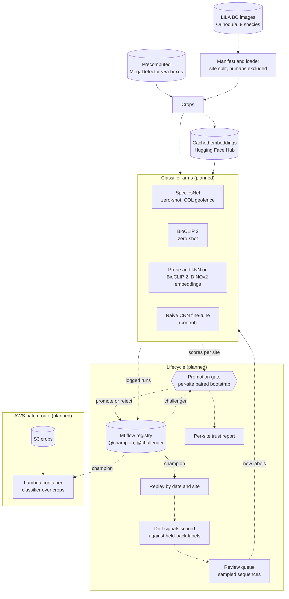

# Camera-Trap MLOps

Status: planning; nothing is built yet.

## The question

Can a small, reproducible lifecycle decide, site by site, whether to
trust a zero-shot camera-trap species classifier or replace it with an
adapted one, and can it tell from unlabelled images when that decision
needs revisiting?

Strong off-the-shelf classifiers already exist (SpeciesNet, BioCLIP 2).
What is rarely published is the accountability around them: how well
they do at camera sites they were never trained on, when an adapted
model has earned the right to replace them, and whether any label-free
signal warns that accuracy has dropped. This project builds that
layer. Finding that the off-the-shelf model should stay in place
everywhere would still be a complete result.

## How it works

The planned components are below. Dashed parts are not built yet; the
diagram is updated as each one lands.

## Data

Orinoquía Camera Traps (Vélez et al. 2023), from
[LILA BC](https://lila.science/datasets/orinoquia-camera-traps/),
released under the
[Community Data License Agreement (permissive)](https://cdla.io/permissive-1-0/).
Images are fetched from LILA's public mirrors and are not stored in this
repository.

## Licence

To be added.
