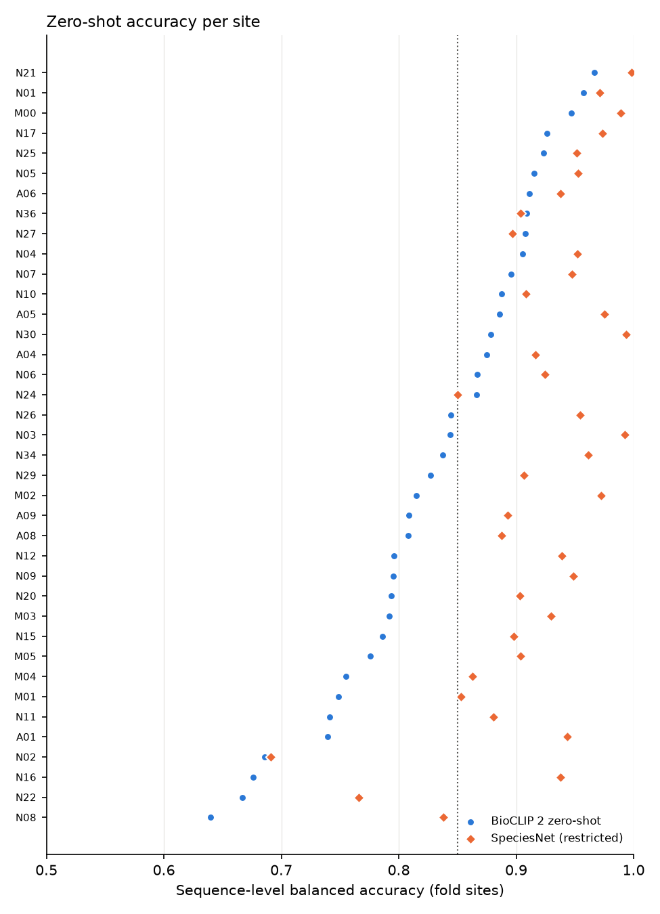
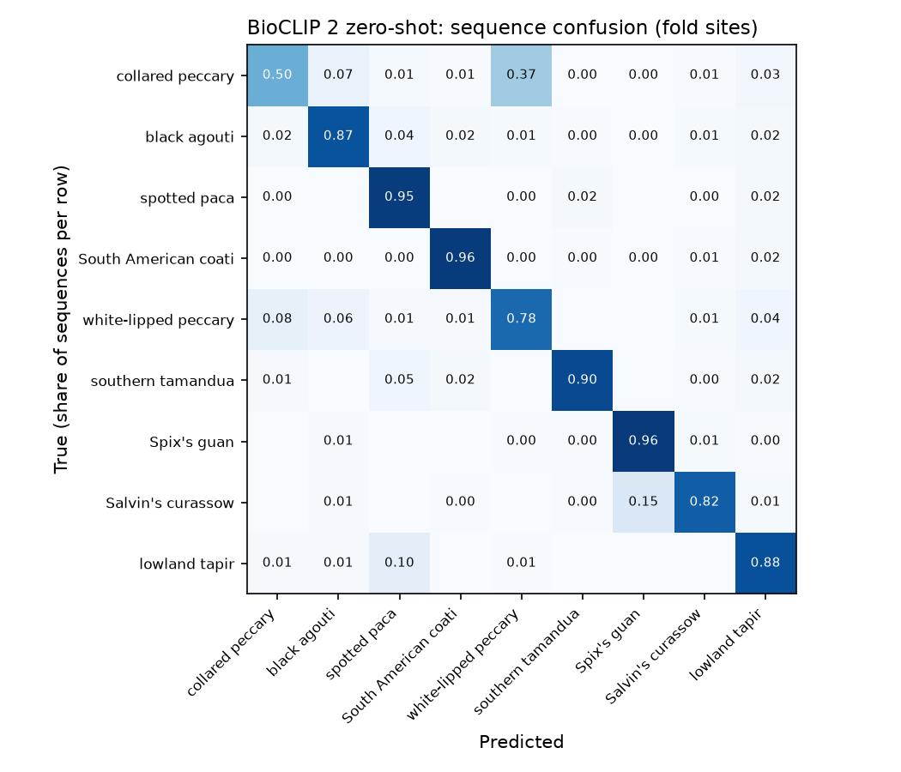
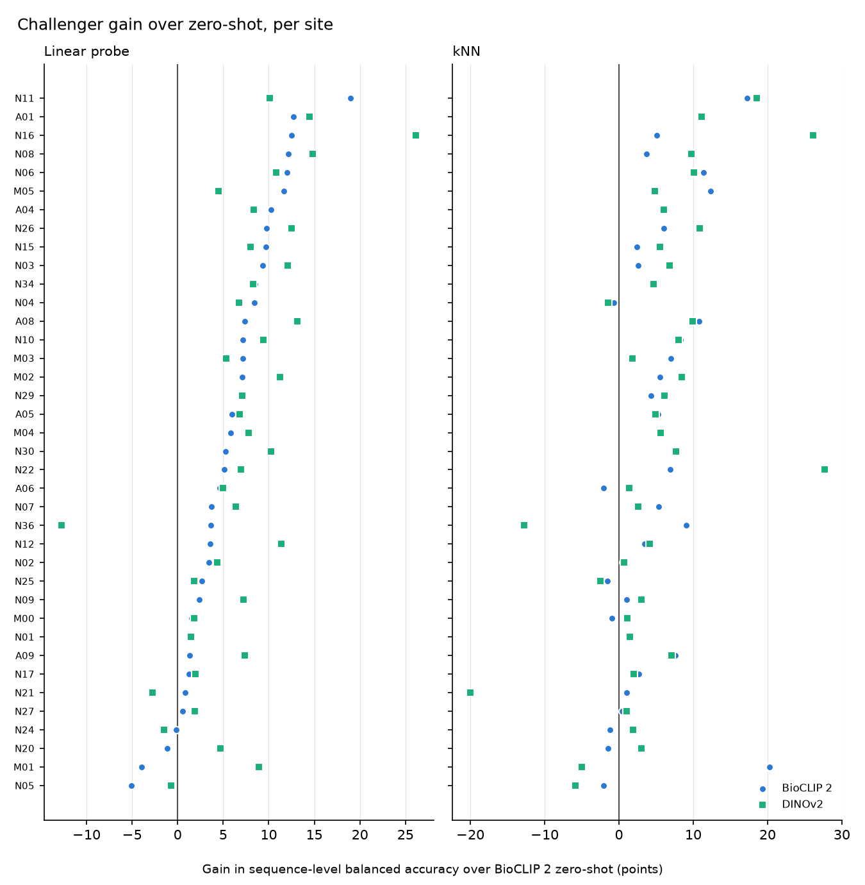
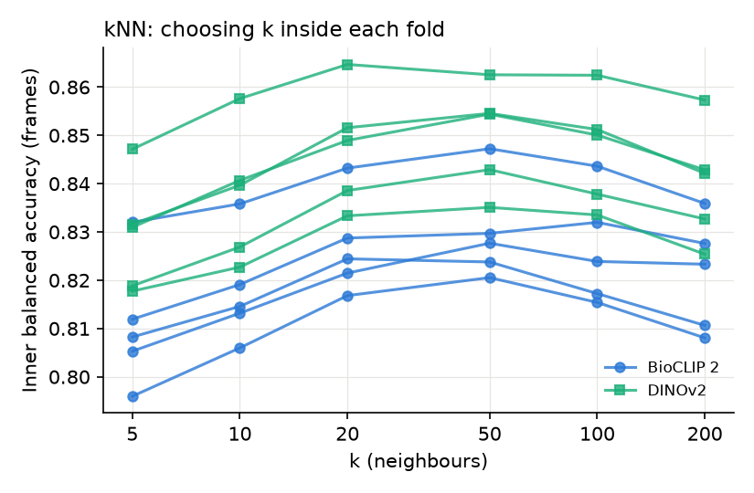
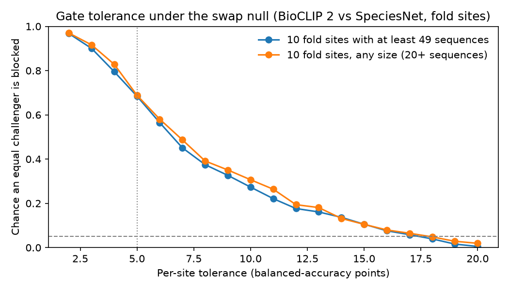
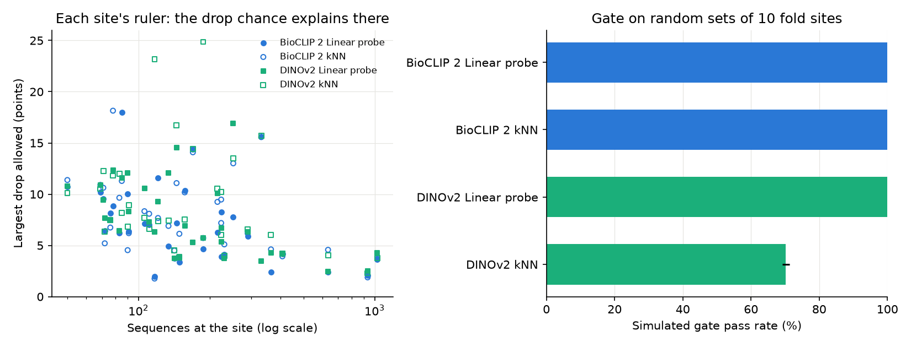
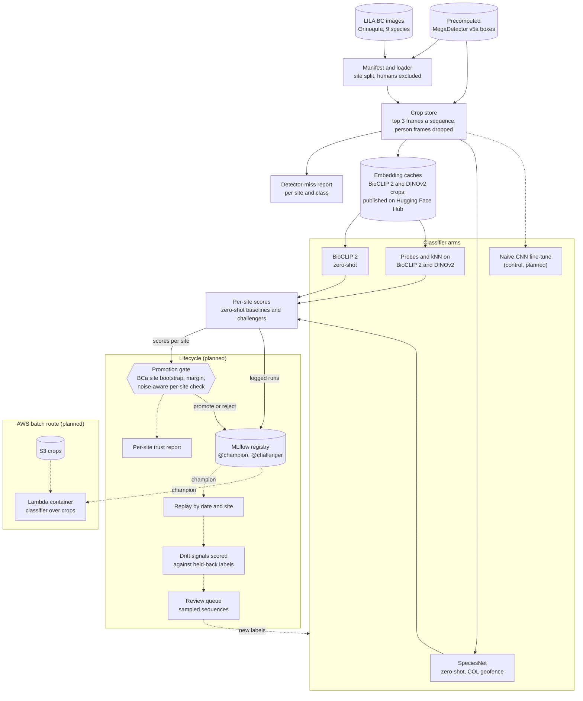

# Camera-Trap MLOps

Status: Phase 3 in progress. Probe and kNN challengers are scored on fold sites, and the DINOv2 probe is chosen as the one challenger to face the hold-out. The hold-out is untouched; the gate settings are about to be frozen.

## The question

Can a small, reproducible lifecycle decide, site by site, whether to
trust a zero-shot camera-trap species classifier or replace it with an
adapted one, and can it tell from unlabelled images when that decision
needs revisiting?

Strong off-the-shelf classifiers already exist (SpeciesNet, BioCLIP 2).
What is rarely published is the accountability around them: how well
they do at camera sites they were never trained on, when an adapted
model has earned the right to replace them, and whether any label-free
signal warns that accuracy has dropped. This project builds that
layer. Finding that the off-the-shelf model should stay in place
everywhere would still be a complete result.

## Answer so far

Zero-shot baselines on every fold sequence: 38 sites, 7,590 sequences,
nine species, up to three crops per sequence with logits averaged
before softmax. None of the ten hold-out sites has been scored.



| Arm | Mean | Median | Worst site | Sites below 0.85 |
| --- | --- | --- | --- | --- |
| BioCLIP 2 zero-shot (champion) | 0.83 | 0.84 | 0.64 | 21 of 38 |
| SpeciesNet, restricted to the nine species | 0.92 | 0.93 | 0.69 | 3 of 38 |

Sequence-level balanced accuracy per site; sites with fewer than 20
sequences are left out.

- BioCLIP 2's main weakness is the two peccaries: it recalls only half
  of collared peccary sequences and calls 37% of them white-lipped
  peccary. Every other species is at 0.78 recall or above.
- SpeciesNet answers 90% of sequences in its own open-set mode, 91% of
  them correctly. It has probably seen these images (they went through
  Wildlife Insights), so none of its scores here are held-out
  performance.
- Small crops are rare but much harder: 695 of 20,991 frames have a
  long side under 224 px, and BioCLIP 2 gets about half of them right,
  against 72% of larger crops.



The first spike, on a capped sample of the same sites (5,337
sequences), gave two further pointers that later phases test properly:

- A linear probe on BioCLIP 2's frozen embeddings averaged 0.89, +4.8
  points over zero-shot.
- Mean model confidence tracked per-site accuracy closely (Spearman
  0.87, 95% interval 0.73 to 0.93), a first hint that a label-free
  signal can flag weak sites.

On the spike sample BioCLIP 2 averaged 0.84 with 18 weak sites; the
full fold set adds the sequences the spike capped away (at most 100
per class per site) and gives 0.83 and 21.

The plan's rule for choosing the dataset, applied at the spike, asked
for at least a quarter of sites below 0.85 with the best zero-shot
model. Read against SpeciesNet that fails (3 of 38 sites); read against
BioCLIP 2 it passes. The
project uses the BioCLIP 2 reading because SpeciesNet's scores here are
not held-out, a choice made after seeing the results and recorded as
such.

Upstream, MegaDetector finds no animal at confidence 0.2 in 58 of 9,451
sequences (0.6%), which therefore reach no classifier. The misses
concentrate in lowland tapir (3.5% of its sequences) and spotted paca
(2.6%); the worst site, N02, loses 5.1%. A further 51 frames where the
detector also sees a person are dropped, costing 4 sequences their only
crops. Per-site and per-class tables are in `results/detector/`.

### Adapted challengers

Two cheap adaptations of each backbone's frozen crop embeddings, both
trained out of fold: every site is scored by a model built only from
the other folds' sites, with its one setting chosen inside those
training sites. Same frames, sequences and metric as the baselines
(`make challengers`; tables in `results/challengers/`).

- **Linear probe:** class-balanced logistic regression; regularisation
  strength C chosen by an inner site split.
- **kNN:** each crop takes the class-weighted vote of its k most similar
  labelled crops (cosine similarity). Votes are weighted by inverse class
  frequency, so the 2,710 collared peccary sequences cannot outvote the
  292 white-lipped on numbers alone, and half a vote is added to every
  class so confidence never reaches exactly 1.0. k is chosen by an inner
  site split from 5 to 200.

| Arm (38 fold sites) | Mean | Median | Worst site | Sites below 0.85 | Mean gain over BioCLIP 2 |
| --- | --- | --- | --- | --- | --- |
| BioCLIP 2 zero-shot (champion) | 0.83 | 0.84 | 0.64 | 21 | — |
| Probe on BioCLIP 2 | 0.89 | 0.91 | 0.71 | 10 | +5.6 points |
| Probe on DINOv2 | 0.90 | 0.92 | 0.73 | 10 | +6.9 points |
| kNN on BioCLIP 2 | 0.88 | 0.90 | 0.68 | 10 | +4.9 points |
| kNN on DINOv2 | 0.88 | 0.89 | 0.69 | 12 | +4.7 points |



- Every challenger improves at least 31 of 38 sites. These are
  fold-site scores, not the gate's decision, which is taken once on
  the sealed hold-out.
- The probes beat kNN on both backbones. kNN is also less even across
  sites: DINOv2's kNN loses 20 points at N21 (117 sequences), where
  zero-shot already scores 0.97, because it leans on whichever few
  training crops sit closest.
- The largest regressions are otherwise at small sites (the DINOv2
  probe loses 12.7 points at N36, which has 24 sequences). This is
  the per-site noise the gate has to allow for.
- DINOv2 was trained without species labels or text, yet its probe
  matches BioCLIP 2's. With a few thousand labelled sequences, the
  backbone's species knowledge matters less than the labels from these
  sites.



The first k grid stopped at 50, which won 8 of 10 inner splits, so the
best k could have lain beyond it. The grid was extended to 200 after
the fold scores had been seen, on the strength of the inner curves
alone, with the rule fixed beforehand that a win at 200 would be
reported as a lower bound rather than extended again. Every curve now
peaks inside the grid, mostly at 50, and the kNN scores moved by at
most 0.1 points.

### The gate's per-site check

The gate promotes a challenger only if its mean per-site gain is above
zero, the lower 95% bound of that gain (BCa bootstrap over sites) is
above a margin of −1 point, and no single site drops by more than
chance explains there. A tie keeps the champion.

The plan started with a fixed per-site tolerance of 5 points. A swap
null showed why that fails: swapping the two models' predictions on a
random half of a site's sequences mimics a challenger exactly as good
as the champion, and with the real challengers a fixed tolerance had to
be 12 to 15 points before an equal challenger was blocked less than 5%
of the time across ten sites. That allowance is set by the noisiest
site, so it means nothing at a site with a thousand sequences.



So each site is judged against its own noise. The swap null gives the
site's drop a p-value, and the site blocks promotion if that p-value is
below 5% divided by the number of sites (a Bonferroni correction). The
chance of wrongly blocking an equal challenger stays at most 5% however
many sites a deployment has, and each site's allowance follows its own
size and how often the two models disagree there. The figure above is
the earlier stand-in calibration (BioCLIP 2 against SpeciesNet), kept
for the record; `make gate-calibrate` reproduces it.

### Choosing the hold-out challenger

Sending all four challengers to the hold-out and promoting whichever
passed would be four tries at one exam. So one is chosen first, on fold
sites only: the full gate is run on 2,000 random sets of ten fold sites
of hold-out size (at least 49 sequences, 33 sites), the same sets for
every challenger, and the challenger with the highest pass rate goes
forward, ties going to the larger mean gain.



| Challenger | Pass rate | Mean gain (points) | Worst site (points) |
|---|---|---|---|
| DINOv2 probe | 100% | +7.2 | −2.8 |
| BioCLIP 2 probe | 100% | +5.8 | −4.0 |
| BioCLIP 2 kNN | 100% | +5.1 | −2.1 |
| DINOv2 kNN | 70% | +4.9 | −20.0 |

- Three challengers pass every set, so the tie-break decides: the
  **DINOv2 probe** goes to the hold-out. Its lead is small but real:
  +1.4 points over the BioCLIP 2 probe, 95% BCa interval +0.1 to +2.8,
  paired by site.
- It was picked for scoring highest, so its fold-site gain flatters it
  (the winner's curse); expect less on the hold-out.
- Allowed drops (left) run from about 2 points at the largest sites to
  over 20 at a few mid-sized ones. Size alone does not set them: a site
  where the two models disagree often, or where a species has only one
  or two sequences, is noisier.
- DINOv2 kNN's 20-point loss at N21 is not flagged. Nearly all of it is
  one sequence: N21 has a single white-lipped peccary, worth a sixth of
  the site's balanced accuracy. kNN still fails 30% of sets, on the
  margin, because that site drags the lower bound down.

## How it works

The components are below. Solid parts are built; dashed parts are
planned, and the diagram is updated as each one lands.



## Data

Orinoquía Camera Traps (Vélez et al. 2023), from
[LILA BC](https://lila.science/datasets/orinoquia-camera-traps/),
released under the
[Community Data License Agreement (permissive)](https://cdla.io/permissive-1-0/).
Images are fetched from LILA's public mirrors and are not stored in this
repository.

The committed manifest, [`data/manifest/orinoquia.csv`](data/manifest/orinoquia.csv),
lists one row per image in a clean single-species sequence of the nine
classes: 65,042 images in 9,451 sequences at 49 sites. It is built from
LILA's metadata and precomputed MegaDetector v5a results, whose URLs and
SHA-256 checksums are recorded in
[`data/manifest/orinoquia.json`](data/manifest/orinoquia.json) along with
the counts of everything dropped. Any sequence that ever showed a person
is dropped whole (those images were removed upstream), as are
multi-species sequences and sequences of other classes.

Splits are by site, never by image. Ten sites with at least 30 sequences
each form the final hold-out, drawn with a fixed seed so that every class
has at least 15 hold-out sequences at two or more sites; the other 39
sites form five grouped folds of about 1,530 sequences each. The draw
uses label counts only, never model scores, and its hash is checked by
the tests so the hold-out cannot move after the freeze.

The first spike uses a smaller selection,
[`data/manifest/orinoquia_spike.csv`](data/manifest/orinoquia_spike.csv),
drawn from the fold sites only, so no hold-out image is downloaded before
the freeze. It holds up to 100 sequences per class per site, keeping in
each the three frames with the most confident MegaDetector animal box
(14,806 images), plus 500 random fold images of any confidence for
checking the precomputed detections against a fresh run. `make fetch`
downloads them (about 11 GB) and writes each image's SHA-256 into the
manifest, so a later download can be checked against it.

## The hold-out freeze

[`config/holdout_freeze.json`](config/holdout_freeze.json) is the
pre-registration record: it fixes everything the hold-out decision depends
on before the hold-out is scored. It holds the gate's settings, the ten
sites, the metric, the champion, the one challenger (DINOv2 probe), and how
that challenger is trained, down to the C grid and inner split. Freezing
only the challenger's name would leave its training open to adjustment after
seeing the result. It also records the hashes of the files it rests on (crop
index, published embeddings, selection results) and the numerical library
versions.

`make freeze` writes it once and refuses to overwrite it, and
`tests/test_holdout_freeze.py` pins its SHA-256, so any change to the file
or the data under it fails the tests and shows up in the git history.

The hold-out is one shot. Its result is reported whether the challenger
passes or fails, and a fail does not send another challenger in. Expect the
score to fall from the fold sites' +7.2 points: it was the best of four, so
it carries some selection luck (the winner's curse).

`make holdout-check` runs every check (freeze hash, inputs, recipe, library
versions, embeddings covering every frame) and stops before fitting or scoring
anything. `make holdout` then fits the challenger on every fold-site frame,
scores both arms on the ten sites, runs the gate and writes `results/holdout/`.
It refuses to overwrite a result; to reproduce one, pass another `--out-dir`
and compare. **The hold-out has not been scored yet.**

## Tracking

`make track` rebuilds a local MLflow store (`mlflow.db` and `mlruns/`, both
git-ignored) from the committed results, so it needs no server or account.
Every challenger becomes a run. Only the champion and the frozen challenger
become versions of the `species-classifier` model, under the aliases
`@champion` and `@challenger`. Once a hold-out result exists, its decision
alone moves them: a pass moves `@champion` and keeps the old one as
`@previous_champion`; a fail leaves `@champion` alone and tags the challenger
as rejected. `mlflow ui --backend-store-uri sqlite:///mlflow.db` browses it.

## Reproducing

Needs [uv](https://docs.astral.sh/uv/) and nothing else: no accounts or
API keys. Python 3.14 on Linux x86-64 or Apple-silicon macOS.

```bash
make install          # core and dev tools: gate, drift, tracking, tests
make install-models   # adds CPU torch, BioCLIP 2, DINOv2 and SpeciesNet
source venv/bin/activate
make test lint format-check
make manifest         # optional: rebuild the manifest from LILA (5 MB download)
make fetch            # optional: download the spike's images (11 GB) and check them
make spike-models     # optional: MDv5a check, BioCLIP 2, SpeciesNet (about 12 h on CPU)
make spike            # score the spike from those caches; writes results/spike/
make detector-report  # detector misses per site and class; committed files only
make fetch-crops      # optional: download every indexed image (20 GB) and check them
make crops            # cut the 25,947 crops to data/crops/
make embed            # optional: BioCLIP 2 and DINOv2 over every crop (about 6 h on CPU)
make speciesnet-crops # optional: SpeciesNet over every crop frame (about 13 h on CPU)
make embed-check      # re-embed 50 cached crops per backbone and compare
make baselines        # zero-shot tables per fold site; writes results/baselines/ and figures/
make challengers      # probes and kNN per fold site (about 12 min); writes results/challengers/
make select-challenger # choose the hold-out challenger by simulated gate pass rate (about 8 min); writes results/selection/
make freeze           # already run: writes config/holdout_freeze.json once and refuses to overwrite it
make holdout-check    # check the freeze, inputs and caches; fits and scores nothing
make holdout          # one shot: score the hold-out and run the gate; writes results/holdout/
make track            # rebuild the MLflow runs and aliases from committed results
make gate-calibrate   # fixed-tolerance false-block rates (stand-in pair, kept for the record); writes results/gate/
```

The model outputs are published on the Hugging Face Hub, so the scoring
can be reproduced without downloading images or running a model:

```bash
make fetch-embeddings # no account needed; checks each file's SHA-256
make baselines
```

`make help` lists every target.

## Licence

Code: [MIT](LICENSE). Data keep their own licences (see Data).
