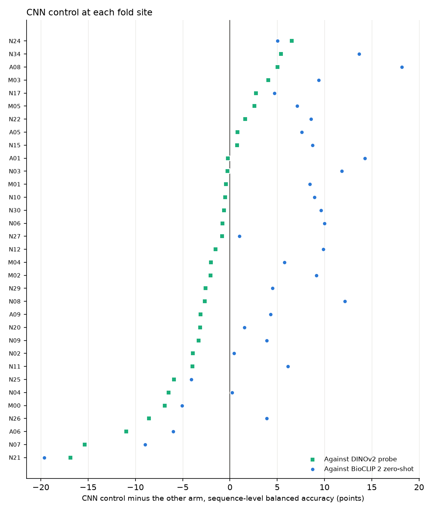
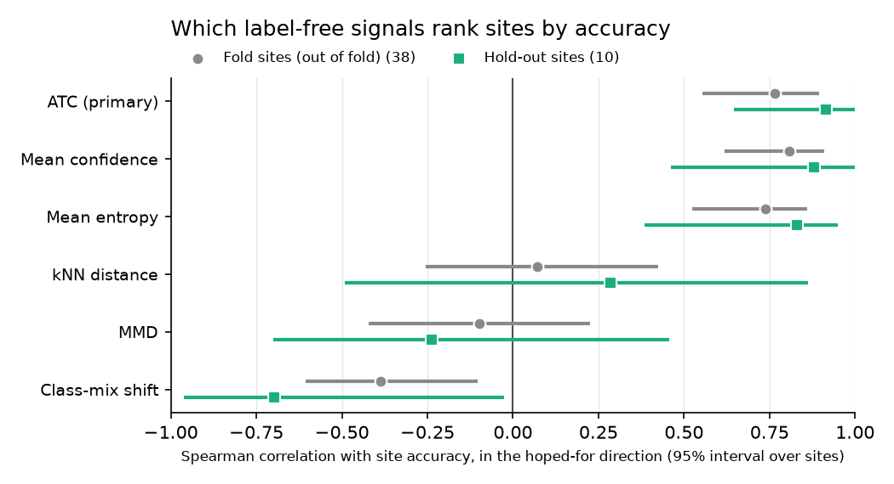
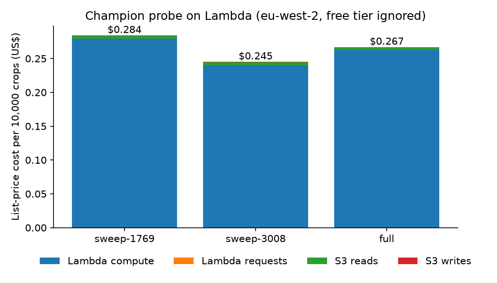
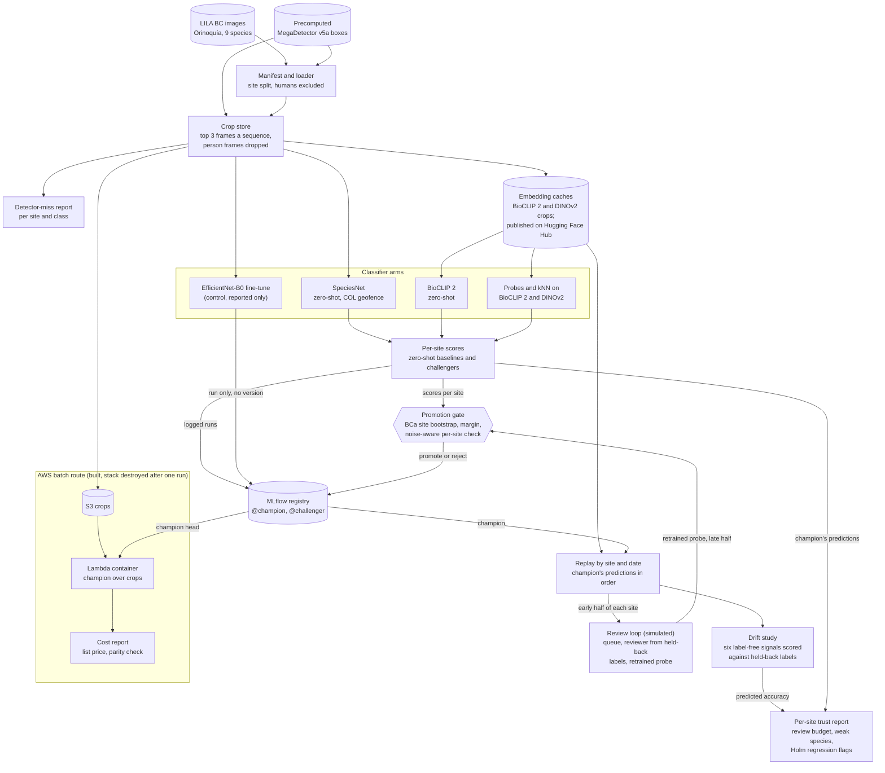

# Camera-Trap MLOps

**Status: in progress.** On ten camera sites held back until the test was fixed, a small trained classifier beat an off-the-shelf model at all ten; see [Answer so far](#answer-so-far). A fully fine-tuned CNN, run as a control, beat the off-the-shelf model but not the simpler trained one. A per-site trust report says how much review a confidence threshold buys. A drift study found that the model's own confidence ranks sites by accuracy without labels, but predicts a site's accuracy only slightly better than guessing the average, and that how far a site's images sit from the training images says nothing. A simulated review loop found that labelling up to 40 sequences at a new site and retraining moved accuracy by less than a point, and that the promotion gate cannot tell so small a gain from a refit with no new labels. The champion also runs as a container on AWS Lambda: all 25,947 crops cost $0.267 per 10,000 at list price, and its logits matched the local model's.

## The question

Can a small, reproducible lifecycle decide, site by site, whether to
trust a zero-shot camera-trap species classifier or replace it with an
adapted one, and can it tell from unlabelled images when that decision
needs revisiting?

Strong off-the-shelf classifiers already exist (SpeciesNet, BioCLIP 2).
What is rarely published is the accountability around them: how well
they do at camera sites they were never trained on, when an adapted
model has earned the right to replace them, and whether any label-free
signal warns that accuracy has dropped. This project builds that
layer. Finding that the off-the-shelf model should stay in place
everywhere would still be a complete result.

## Answer so far

**On ten sites held out until the settings were frozen, a linear probe on
DINOv2 embeddings passed the promotion gate against BioCLIP 2 zero-shot.**
Its mean gain is +9.7 points of sequence-level balanced accuracy (95% BCa
interval +5.5 to +15.0), and it improved at all ten sites.


| Site mean, 10 hold-out sites | Balanced accuracy |
| --- | --- |
| BioCLIP 2 zero-shot | 0.836 |
| DINOv2 probe | 0.933 |

- The largest single improvement is collared peccary, BioCLIP 2's known
  weakness: pooled recall rises from 0.63 to 0.86 over 491 sequences. Lowland
  tapir falls from 0.95 to 0.90, which is one sequence of 20.
- The smallest gains are near zero: +0.2 at N14, +0.7 at N00, +1.3 at N31. No
  site dropped, so the per-site check had nothing to judge.
- The gain is above the fold sites' +7.2, not below as forecast, but the
  interval includes +7.2, so this is not evidence of a larger true gain.
  Looked at after the fact, the three hold-out sites named A gain +18.0 and the
  seven named N gain +6.2 (fold sites: +9.3 and +6.9). Three sites are too
  few to explain this.
- **What it does not show.** These are new sites in the same study region, so
  it says nothing about a new region. The probe needs labelled data from the
  region, where zero-shot needs none. The hold-out is now spent: anything later
  scored on it is reported for comparison and cannot be a fresh test.

Zero-shot baselines on every fold sequence: 38 sites, 7,590 sequences,
nine species, up to three crops per sequence with logits averaged
before softmax.


| Arm | Mean | Median | Worst site | Sites below 0.85 |
| --- | --- | --- | --- | --- |
| BioCLIP 2 zero-shot (champion) | 0.83 | 0.84 | 0.64 | 21 of 38 |
| SpeciesNet, restricted to the nine species | 0.92 | 0.93 | 0.69 | 3 of 38 |

Sequence-level balanced accuracy per site; sites with fewer than 20
sequences are left out.

- BioCLIP 2's main weakness is the two peccaries: it recalls only half
  of collared peccary sequences and calls 37% of them white-lipped
  peccary. Every other species is at 0.78 recall or above.
- SpeciesNet answers 90% of sequences in its own open-set mode, 91% of
  them correctly. It has probably seen these images (they went through
  Wildlife Insights), so none of its scores here are held-out
  performance.
- Small crops are rare but much harder: 695 of 20,991 frames have a
  long side under 224 px, and BioCLIP 2 gets about half of them right,
  against 72% of larger crops.


The first spike, on a capped sample of the same sites (5,337
sequences), gave two further pointers that later phases test properly:

- A linear probe on BioCLIP 2's frozen embeddings averaged 0.89, +4.8
  points over zero-shot.
- Mean model confidence tracked per-site accuracy closely (Spearman
  0.87, 95% interval 0.73 to 0.93), a first hint that a label-free
  signal can flag weak sites.

On the spike sample BioCLIP 2 averaged 0.84 with 18 weak sites; the
full fold set adds the sequences the spike capped away (at most 100
per class per site) and gives 0.83 and 21.

The plan's rule for choosing the dataset, applied at the spike, asked
for at least a quarter of sites below 0.85 with the best zero-shot
model. Read against SpeciesNet that fails (3 of 38 sites); read against
BioCLIP 2 it passes. The
project uses the BioCLIP 2 reading because SpeciesNet's scores here are
not held-out, a choice made after seeing the results and recorded as
such.

Upstream, MegaDetector finds no animal at confidence 0.2 in 58 of 9,451
sequences (0.6%), which therefore reach no classifier. The misses
concentrate in lowland tapir (3.5% of its sequences) and spotted paca
(2.6%); the worst site, N02, loses 5.1%. A further 51 frames where the
detector also sees a person are dropped, costing 4 sequences their only
crops. Per-site and per-class tables are in `results/detector/`.

### Adapted challengers

Two cheap adaptations of each backbone's frozen crop embeddings, both
trained out of fold: every site is scored by a model built only from
the other folds' sites, with its one setting chosen inside those
training sites. Same frames, sequences and metric as the baselines
(`make challengers`; tables in `results/challengers/`).

- **Linear probe:** class-balanced logistic regression; regularisation
  strength C chosen by an inner site split.
- **kNN:** each crop takes the class-weighted vote of its k most similar
  labelled crops (cosine similarity). Votes are weighted by inverse class
  frequency, so the 2,710 collared peccary sequences cannot outvote the
  292 white-lipped on numbers alone, and half a vote is added to every
  class so confidence never reaches exactly 1.0. k is chosen by an inner
  site split from 5 to 200.

| Arm (38 fold sites) | Mean | Median | Worst site | Sites below 0.85 | Mean gain over BioCLIP 2 |
| --- | --- | --- | --- | --- | --- |
| BioCLIP 2 zero-shot (champion) | 0.83 | 0.84 | 0.64 | 21 | — |
| Probe on BioCLIP 2 | 0.89 | 0.91 | 0.71 | 10 | +5.6 points |
| Probe on DINOv2 | 0.90 | 0.92 | 0.73 | 10 | +6.9 points |
| kNN on BioCLIP 2 | 0.88 | 0.90 | 0.68 | 10 | +4.9 points |
| kNN on DINOv2 | 0.88 | 0.89 | 0.69 | 12 | +4.7 points |


- Every challenger improves at least 31 of 38 sites. These are
  fold-site scores, not the gate's decision, which is taken once on
  the sealed hold-out.
- The probes beat kNN on both backbones. kNN is also less even across
  sites: DINOv2's kNN loses 20 points at N21 (117 sequences), where
  zero-shot already scores 0.97, because it leans on whichever few
  training crops sit closest.
- The largest regressions are otherwise at small sites (the DINOv2
  probe loses 12.7 points at N36, which has 24 sequences). This is
  the per-site noise the gate has to allow for.
- DINOv2 was trained without species labels or text, yet its probe
  matches BioCLIP 2's. With a few thousand labelled sequences, the
  backbone's species knowledge matters less than the labels from these
  sites.


The first k grid stopped at 50, which won 8 of 10 inner splits, so the
best k could have lain beyond it. The grid was extended to 200 after
the fold scores had been seen, on the strength of the inner curves
alone, with the rule fixed beforehand that a win at 200 would be
reported as a lower bound rather than extended again. Every curve now
peaks inside the grid, mostly at 50, and the kNN scores moved by at
most 0.1 points.

### The gate's per-site check

The gate promotes a challenger only if its mean per-site gain is above
zero, the lower 95% bound of that gain (BCa bootstrap over sites) is
above a margin of −1 point, and no single site drops by more than
chance explains there. A tie keeps the champion.

The plan started with a fixed per-site tolerance of 5 points. A swap
null showed why that fails: swapping the two models' predictions on a
random half of a site's sequences mimics a challenger exactly as good
as the champion, and with the real challengers a fixed tolerance had to
be 12 to 15 points before an equal challenger was blocked less than 5%
of the time across ten sites. That allowance is set by the noisiest
site, so it means nothing at a site with a thousand sequences.


So each site is judged against its own noise. The swap null gives the
site's drop a p-value, and the site blocks promotion if that p-value is
below 5% divided by the number of sites (a Bonferroni correction). The
chance of wrongly blocking an equal challenger stays at most 5% however
many sites a deployment has, and each site's allowance follows its own
size and how often the two models disagree there. The figure above is
the earlier stand-in calibration (BioCLIP 2 against SpeciesNet), kept
for the record; `make gate-calibrate` reproduces it.

### Choosing the hold-out challenger

Sending all four challengers to the hold-out and promoting whichever
passed would be four tries at one exam. So one is chosen first, on fold
sites only: the full gate is run on 2,000 random sets of ten fold sites
of hold-out size (at least 49 sequences, 33 sites), the same sets for
every challenger, and the challenger with the highest pass rate goes
forward, ties going to the larger mean gain.


| Challenger | Pass rate | Mean gain (points) | Worst site (points) |
|---|---|---|---|
| DINOv2 probe | 100% | +7.2 | −2.8 |
| BioCLIP 2 probe | 100% | +5.8 | −4.0 |
| BioCLIP 2 kNN | 100% | +5.1 | −2.1 |
| DINOv2 kNN | 70% | +4.9 | −20.0 |

- Three challengers pass every set, so the tie-break decides: the
  **DINOv2 probe** goes to the hold-out. Its lead is small but real:
  +1.4 points over the BioCLIP 2 probe, 95% BCa interval +0.1 to +2.8,
  paired by site.
- It was picked for scoring highest, so its fold-site gain flatters it
  (the winner's curse), so less was expected on the hold-out. It scored
  +9.7, with an interval that includes +7.2.
- Allowed drops (left) run from about 2 points at the largest sites to
  over 20 at a few mid-sized ones. Size alone does not set them: a site
  where the two models disagree often, or where a species has only one
  or two sequences, is noisier.
- DINOv2 kNN's 20-point loss at N21 is not flagged. Nearly all of it is
  one sequence: N21 has a single white-lipped peccary, worth a sixth of
  the site's balanced accuracy. kNN still fails 30% of sets, on the
  margin, because that site drags the lower bound down.

### The CNN control

A control is an arm expected to lose, there to show what the frozen-embedding
route is beating. This one fine-tunes every layer of an ImageNet EfficientNet-B0
on the same crops and site folds as the probes, with the same class balancing,
so a loss cannot be blamed on the imbalance. The recipe (`arms/cnn.py`) has no
tuning step and was fixed before any fold was scored.

It is reported only. The hold-out is spent, so the control is scored out of
fold on the fold sites and never on a hold-out frame. It is logged as an MLflow
run with no model version, so no alias can point at it whatever its result. Two
limits apply to the comparison: the DINOv2 probe was selected on these same
sites, so its score is slightly optimistic, and one training seed leaves the
CNN's training noise unmeasured.

**Result:** the control lands between the two, closer to the probe. Scored out of fold on 7,590 sequences from 38 fold sites, its mean
site balanced accuracy is 88.5%, against 90.0% for the DINOv2 probe and 83.2% for
BioCLIP 2 zero-shot. The gate is run against both on the 33 sites with at least
49 sequences, as a reference only, since a control cannot be promoted:

| CNN control against | Mean gain (points) | 95% BCa interval | Sites ahead | Flagged drops | Gate |
| --- | --- | --- | --- | --- | --- |
| DINOv2 probe | −2.2 | −4.3 to −0.7 | 9 of 33 | A06, N25 | would fail |
| BioCLIP 2 zero-shot | +5.0 | +2.0 to +7.1 | 28 of 33 | none | would pass |



- Fine-tuning a whole network beats the zero-shot model, but a linear probe on
  frozen DINOv2 embeddings does better still, at a fraction of the cost: the
  probe trains in seconds, while the CNN took about 14 hours on CPU.
- Most of the CNN's loss is one confusion: it called 141 of 292 white-lipped
  peccary sequences collared peccary (recall 47%, against 72% for the probe).
  A06 and N25, the two flagged sites, are among those with the most
  white-lipped peccaries. The CNN does best on collared peccary itself (93%
  against 88%), so it learnt to favour the common one of the two.
- Per-site and per-class tables are in `results/control/`.

### The trust report

The trust report (`make trust-report`, written to
`results/trust/trust_report.md`) is a per-site audit of the champion, the
DINOv2 probe, for someone deciding how far to trust its labels. It is
retrospective: it covers sites that have labels. Beside each site's observed
accuracy it shows the accuracy [the drift study](#the-drift-study) predicts
without labels, which is all a new site would get. It covers all 49 sites:
the 39 fold sites, scored out of fold but optimistic because the probe was
chosen there, and the 10 hold-out sites, scored once by the frozen model. Its
rules were written into the plan before any of its numbers were computed.

**Review budget.** A sequence whose top class probability reaches a threshold
is accepted without review, and the rest go to a reviewer, who is assumed to
correct them. The suggested threshold is the lowest whose residual error (wrong
and unreviewed, over all sequences) is at most 5% on the fold sites, chosen
there only. That is 0.5, and on the hold-out sites it sends 6.6% of sequences to
review and leaves 4.1% wrong, against 7.8% with no review. A stricter 0.7 sends
17.8% to review and leaves 1.2% wrong. The probabilities come from a
class-balanced probe and are not calibrated, so the threshold is read off this
table rather than as "70% sure".


- **Regressions.** No site is worse than under BioCLIP 2 zero-shot (Holm over
  49 sites, alpha 0.05). Fourteen sites, three of them hold-out sites, are
  labelled "too little data to judge": the two models disagree on too few
  sequences there (nine or fewer) for any drop to be detectable, so they are
  unchecked, not passed, and belong with a specialist reviewer.
- **Weak species.** Eight site-species cells have recall below 70% with at
  least five sequences. Three are white-lipped peccary called collared peccary,
  the confusion that also sank the CNN control; N29 is the worst, at 42% of 43
  sequences.
- The per-site accuracy intervals resample sequences as if independent, which
  they are not at one site, so they are too narrow.
- Tables (per site, per site and species, per threshold) are in
  `results/trust/`.

### The drift study

Once a model is deployed at a new site there are no labels, so the question
is whether anything computable without them says how accurate it is there.
The drift study (`make drift`) replays every sequence through the champion in
site and date order, computes six label-free signals per site, and scores each
against the labels held back from it. The signals, the one named as primary,
the minimum sizes and the use of the hold-out were written into the plan
before any signal was computed.

Three signals come from the model's own probabilities: mean confidence (the
top class probability), mean entropy, and ATC
([Garg et al. 2022](https://arxiv.org/abs/2201.04234)), the primary. ATC
learns one confidence threshold on labelled sites, set so that the share of
sequences above it equals their accuracy, and predicts a new site's accuracy
as its share above that threshold. Two come from the embeddings: the distance
from a site's sequences to their nearest training sequences (kNN distance),
and MMD ([Gretton et al. 2012](https://jmlr.org/papers/v13/gretton12a.html)),
a measure of how differently two sets of vectors are distributed. The last is
how far the site's mix of predicted species is from the training mix. Nothing
a site is judged by was learnt from it: for a fold site the model, the
threshold and the training reference come from the other four folds; for a
hold-out site, from all fold sites, applied once.


- **Confidence ranks sites.** ATC's Spearman correlation with site accuracy
  is 0.76 over 38 fold sites (95% interval 0.55 to 0.89, resampling sites).
  On the 10 hold-out sites it is 0.92 (0.65 to 1.00), which agrees but rests
  on too few sites to add much. Mean confidence (0.81) and entropy (-0.74)
  do the same job.
- **As a predicted accuracy it is only slightly better than guessing the
  average.** On the hold-out sites ATC is off by 2.1 points on average, where
  giving every site the fold sites' mean accuracy is off by 3.2. The gain of
  1.1 points has an interval of -0.5 to +2.7, which includes zero, and the
  fold sites say the same (2.8 against 3.9; +1.1, -0.3 to +2.6). Sites here
  differ little (most score 85% to 99%), so the average is hard to beat. ATC
  also ran 1.7 points high on the hold-out.
- **Distance from the training images says nothing.** kNN distance (-0.07,
  interval -0.43 to 0.26) and MMD (+0.10, -0.23 to 0.42) show no relationship
  with accuracy. These are new sites in the same region, so the embeddings
  barely move; a new region might differ and is untested.
- **Class-mix shift points the wrong way.** Sites whose predicted species mix
  differs most from the training mix were more accurate, not less (+0.39,
  0.10 to 0.61). Unexplained; a site dominated by one easy species would do
  it, but that was not checked.
- **Over time, a fall in confidence goes with a fall in accuracy.** Each
  site's sequences were split into an early and a late half. Over the 34 fold
  sites with at least 20 sequences in each, the change in mean confidence
  correlates with the change in accuracy at 0.65 (0.33 to 0.87), and ATC at
  0.61 (0.25 to 0.88). Accuracy changes there spread 1.5 times wider than
  chance alone would give, so there was some real change to find. On the
  hold-out sites there was almost none (1.1 times), and the correlation is
  uninformative (ATC -0.25, interval -0.86 to 0.64).



In the figure each correlation is flipped where a higher signal should mean
lower accuracy (entropy, the two distances, class-mix shift), so a point to the
right of zero is a signal working as hoped; the numbers in the text are unflipped.

- **What it does not show.** Seven months at one study area: no season, no
  new region, no camera change. A straight line fitted from mean confidence to
  accuracy did a little better than ATC on the hold-out (off by 1.6 points;
  gain over the average +1.6, interval +0.2 to +3.1), but it was a secondary
  measure and is one of several, so it is not the headline. The fold sites
  are optimistic, because the probe was selected on them.
- Tables are in `results/drift/`: the replayed stream with per-sequence
  signals, per-site signals and predictions, and each signal's scores.

### The review loop

When the drift study says a site may have slipped, the next step is to have a
person label some of its sequences and retrain. The review loop
(`make review`) simulates that and asks how many labels it takes, which
sequences are worth a reviewer's time, and whether the gate promotes the
retrained model. The sites, the split, the queues, the budgets and the one
headline comparison were written into the plan before anything was scored.

- **New sites.** The 39 fold sites, each new to a probe fitted on the other
  four folds. The ten hold-out sites repeat the exercise once; that hold-out
  is already spent, so it is a replication, never a fresh test.
- **Split by time.** A reviewer may label only from the first half of each
  site's sequences, in date order, and the retrained model is scored on the
  second half. A random split would flatter it: 36% of sequences follow a
  same-species sequence at the same camera within ten minutes.
- **Three queues**, each built from the champion's predictions alone, no
  labels: random (five seeds); least confident first; and one that takes
  turns across predicted species and, among a species' least confident
  sequences, picks the one least like anything already chosen.
- **Budgets** of 5, 10, 20 and 40 sequences per site, plus every early
  sequence as a ceiling. The reviewer is simulated from held-back labels and
  never errs. Retraining keeps the probe's recipe and adds the reviewed
  frames, either counted like any other frame or counted ten times.

Named in advance as the headline: the third queue at 20 sequences per site,
new labels counted once.

**The retrained model passed the gate, on a gain too small to matter.** With
680 reviewed sequences across 34 scored sites, mean balanced accuracy on the
later halves rose by 0.3 points (95% BCa interval +0.1 to +0.6): 23 of 3,751
sequences fixed and 5 broken. On the hold-out the same cell gained 0.5 points
(0.0 to +1.5) and also passed.


- **More labels did not help.** No budget, queue or weight gained more than
  0.9 points on the fold sites. Labelling every early sequence (3,734 of
  them) gave -0.1 points counted once and +0.5 (-1.2 to +1.2) counted ten
  times. The champion already scores 91.1 at these sites, which leaves little
  to recover.
- **No queue was shown to beat random.** The headline queue was 0.2 points
  ahead of random at 20 sequences (+0.0 to +0.4), which is one comparison of
  sixteen and was not repeated at other budgets or on the hold-out (+0.1,
  -0.1 to +0.4). Least confident first with labels counted ten times was
  0.9 points behind random at 40 sequences (-2.2 to +0.1).
- **The gate cannot see gains this small.** Refitting the probe with no new
  labels at all flips 12 sequences between right and wrong through numerical
  differences alone, comes out 0.07 points ahead, and passes. So do 44 of the 56 cells on the
  fold sites. The gate asks only that a challenger be better on average and
  not worse by a point, which was the right test for replacing a zero-shot
  model (+9.7 points) and is too weak for routine retraining. A minimum gain
  above this noise floor is the obvious repair; it is not applied here,
  because the gate was frozen before these results were seen.
- **What it does not show.** One linear probe, a perfect reviewer, one batch
  of labels with no second round, and seven months at one study area. A
  site with a species the training sites lack, or a model with more capacity
  to adapt, could behave differently. Upweighting fixed more sequences (87
  at 20 per site) and broke more (26).
- Tables are in `results/review/`: the first 40 of every queue, the gate's
  decision for every cell, per-site gains, each queue against random, and
  the headline cell's predictions. `make track` logs every cell as an MLflow
  run tagged with its decision; none moves an alias.

### The AWS batch route

The champion (DINOv2 ViT-B/14 at 224 px and the saved linear head) runs as a
Lambda container over every crop. `make cloud-report` turns the run's files
into the table and figure below, so the cost and speed are measured, not
borrowed from a pricing page. All of it is list price in eu-west-2 with the
free tier ignored, from a price snapshot committed in
[`data/prices/`](data/prices/aws-eu-west-2.json).



| Run | Memory | Invocations | Crops per billed second | Cost per 10k crops |
| --- | --- | --- | --- | --- |
| Sweep, 512 crops, shards of 64, one at a time | 1,769 MB | 8 | 1.41 (warm) | $0.210 (warm) |
| Sweep, same crops | 3,008 MB | 8 | 2.14 (warm) | $0.234 (warm) |
| **Full run, 25,947 crops, shards of 256, 8 at a time** | 1,769 MB | 102 | **1.10** | **$0.267** |

- **Headline.** $0.267 per 10,000 crops for the full run, with all 8 cold
  starts included: $0.693 in all, of which Lambda compute is $0.681. The
  Lambda requests and S3 reads and writes together come to about $0.01.
- **The size was picked by a rule written before measuring.** The sweep's
  warm invocations were cheaper per crop at 1,769 MB, because 3,008 MB is
  1.5 times faster but costs 1.7 times more a second, so the full run used
  1,769 MB. The cold starts in the 8-invocation sweep make the picture look
  the other way round in the figure; the rule compared warm invocations.
- **Slower than the sweep.** The full run's warm invocations ran at 1.11
  crops per billed second against the sweep's 1.41, which is why the cost
  is $0.265 warm rather than the sweep's $0.210. The difference is
  observed with eight invocations at a time; the cause was not investigated.
- **Same answers as the local model.** The Lambda logits differ from the
  head applied to the cached embeddings by at most 0.00045, no crop or
  sequence prediction differs, and all 1,799 hold-out sequence predictions
  match the committed ones. Parity is a condition of reporting. The run
  reports no accuracy: the fold sites' crops are in the head's training data.
- **What the experiment cost to stand up.** About $0.14, nearly all of it
  25,947 upload requests at one PUT each (the real upload was resumed and
  retried, so it sent a few more). Storage for the 6 hours 47 minutes the
  stack stood came to under $0.002. The stack was destroyed afterwards:
  Terraform removed 11 resources and a tag search found nothing left
  ([`stack.json`](results/cloud/stack.json)).
- **What it does not show.** One region, one run on one day, one container
  and no accuracy claim. Peak memory was 1,758 MB of the 1,769 MB limit, so
  there is no headroom; a different crop mix could run out and would need
  the 3,008 MB size. This is the measured price of the route; it is not
  compared with running the same crops on a laptop or a rented server.
- Tables are in `results/cloud/`: every invocation (billed time, memory,
  cold or warm), the parity checks, the logits and `summary.json`. Rerunning
  `make cloud-report` needs no account; repeating the run needs an AWS
  account and costs about a dollar.

## How it works

The components are below. Solid parts are built; dashed parts are
planned, and the diagram is updated as each one lands.



## Data

Orinoquía Camera Traps (Vélez et al. 2023), from
[LILA BC](https://lila.science/datasets/orinoquia-camera-traps/),
released under the
[Community Data License Agreement (permissive)](https://cdla.io/permissive-1-0/).
Images are fetched from LILA's public mirrors and are not stored in this
repository.

The committed manifest, [`data/manifest/orinoquia.csv`](data/manifest/orinoquia.csv),
lists one row per image in a clean single-species sequence of the nine
classes: 65,042 images in 9,451 sequences at 49 sites. It is built from
LILA's metadata and precomputed MegaDetector v5a results, whose URLs and
SHA-256 checksums are recorded in
[`data/manifest/orinoquia.json`](data/manifest/orinoquia.json) along with
the counts of everything dropped. Any sequence that ever showed a person
is dropped whole (those images were removed upstream), as are
multi-species sequences and sequences of other classes.

Splits are by site, never by image. Ten sites with at least 30 sequences
each form the final hold-out, drawn with a fixed seed so that every class
has at least 15 hold-out sequences at two or more sites; the other 39
sites form five grouped folds of about 1,530 sequences each. The draw
uses label counts only, never model scores, and its hash is checked by
the tests so the hold-out cannot move after the freeze.

The first spike uses a smaller selection,
[`data/manifest/orinoquia_spike.csv`](data/manifest/orinoquia_spike.csv),
drawn from the fold sites only, so no hold-out image is downloaded before
the freeze. It holds up to 100 sequences per class per site, keeping in
each the three frames with the most confident MegaDetector animal box
(14,806 images), plus 500 random fold images of any confidence for
checking the precomputed detections against a fresh run. `make fetch`
downloads them (about 11 GB) and writes each image's SHA-256 into the
manifest, so a later download can be checked against it.

## The hold-out freeze

[`config/holdout_freeze.json`](config/holdout_freeze.json) is the
pre-registration record: it fixes everything the hold-out decision depends
on before the hold-out is scored. It holds the gate's settings, the ten
sites, the metric, the champion, the one challenger (DINOv2 probe), and how
that challenger is trained, down to the C grid and inner split. Freezing
only the challenger's name would leave its training open to adjustment after
seeing the result. It also records the hashes of the files it rests on (crop
index, published embeddings, selection results) and the numerical library
versions.

`make freeze` writes it once and refuses to overwrite it, and
`tests/test_holdout_freeze.py` pins its SHA-256, so any change to the file
or the data under it fails the tests and shows up in the git history.

The hold-out is one shot. Its result is reported whether the challenger
passes or fails, and a fail does not send another challenger in.

`make holdout-check` runs every check (freeze hash, inputs, recipe, library
versions, embeddings covering every frame) and stops before fitting or scoring
anything. `make holdout` then fits the challenger on every fold-site frame,
scores both arms on the ten sites, runs the gate and writes `results/holdout/`.
It refuses to overwrite a result; to reproduce one, pass another `--out-dir`
and compare. A rerun here (about 2 minutes) matched every output byte for byte.

## Tracking

`make track` rebuilds a local MLflow store (`mlflow.db` and `mlruns/`, both
git-ignored) from the committed results, so it needs no server or account.
Every challenger becomes a run. Only the champion and the frozen challenger
become versions of the `species-classifier` model, under the aliases
`@champion` and `@challenger`. Once a hold-out result exists, its decision
alone moves them: a pass moves `@champion` and keeps the old one as
`@previous_champion`; a fail leaves `@champion` alone and tags the challenger
as rejected. The CNN control is a run with no version, so it can move nothing.
`mlflow ui --backend-store-uri sqlite:///mlflow.db` browses it.

## Reproducing

Needs [uv](https://docs.astral.sh/uv/) and nothing else: no accounts or
API keys. Python 3.14 on Linux x86-64 or Apple-silicon macOS.

```bash
make install          # core and dev tools: gate, drift, tracking, tests
make install-models   # adds CPU torch, BioCLIP 2, DINOv2 and SpeciesNet
source venv/bin/activate
make test lint format-check
make manifest         # optional: rebuild the manifest from LILA (5 MB download)
make fetch            # optional: download the spike's images (11 GB) and check them
make spike-models     # optional: MDv5a check, BioCLIP 2, SpeciesNet (about 12 h on CPU)
make spike            # score the spike from those caches; writes results/spike/
make detector-report  # detector misses per site and class; committed files only
make fetch-crops      # optional: download every indexed image (20 GB) and check them
make crops            # cut the 25,947 crops to data/crops/
make embed            # optional: BioCLIP 2 and DINOv2 over every crop (about 6 h on CPU)
make speciesnet-crops # optional: SpeciesNet over every crop frame (about 13 h on CPU)
make embed-check      # re-embed 50 cached crops per backbone and compare
make baselines        # zero-shot tables per fold site; writes results/baselines/ and figures/
make challengers      # probes and kNN per fold site (about 12 min); writes results/challengers/
make select-challenger # choose the hold-out challenger by simulated gate pass rate (about 8 min); writes results/selection/
make freeze           # already run: writes config/holdout_freeze.json once and refuses to overwrite it
make holdout-check    # check the freeze, inputs and caches; fits and scores nothing
make holdout          # one shot: score the hold-out and run the gate; writes results/holdout/
make cnn-control      # optional: fine-tune the CNN control (about 14 h on CPU, resumes); writes its logits to results/control/
make control          # report the control from its committed logits; writes results/control/ and figures/
make drift            # replay the champion and score six label-free signals (about 7 min, needs the embedding caches); writes results/drift/
make review           # simulate the review loop: queue, label, retrain, gate (about 20 min on 8 cores, needs the embedding caches); writes results/review/
make trust-report     # per-site trust report for the champion, with drift's predicted accuracy (about 3 min); writes results/trust/ and figures/
make cloud-report     # cost report from the committed run files; writes results/cloud/summary.json and figures/
make track            # rebuild the MLflow runs and aliases from committed results
make gate-calibrate   # fixed-tolerance false-block rates (stand-in pair, kept for the record); writes results/gate/
```

The model outputs are published on the Hugging Face Hub, so the scoring
can be reproduced without downloading images or running a model:

```bash
make fetch-embeddings # no account needed; checks each file's SHA-256
make baselines
```

`make help` lists every target.

## Licence

Code: [MIT](LICENSE). Data keep their own licences (see Data).
