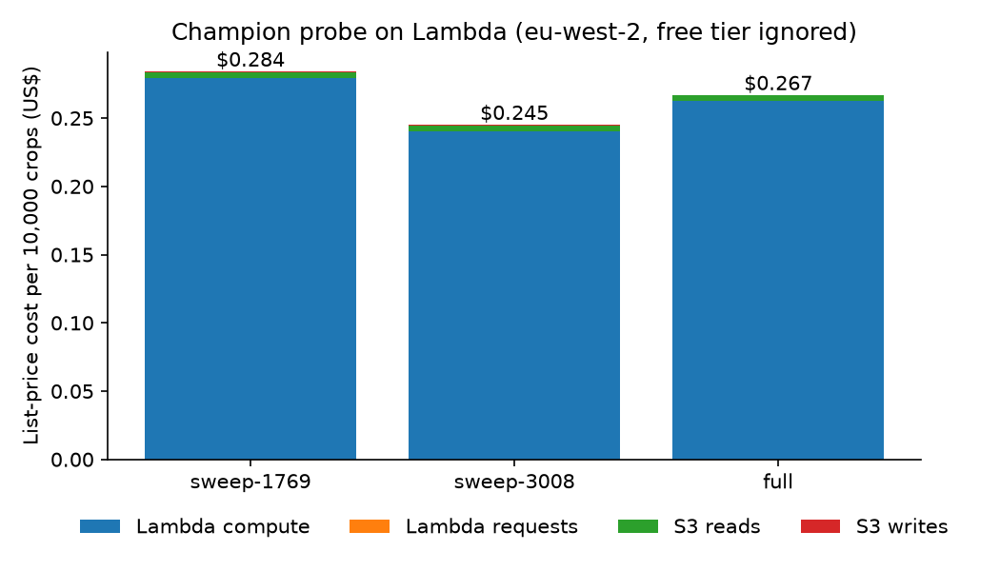

# The AWS batch route

[Back to the README](../README.md)

The champion (DINOv2 ViT-B/14 at 224 px and the saved linear head) runs as a
Lambda container over every crop. `make cloud-report` turns the run's files
into the table and figure below, so the cost and speed are measured, not
borrowed from a pricing page. All of it is list price in eu-west-2 with the
free tier ignored, from a price snapshot committed in
[`data/prices/`](../data/prices/aws-eu-west-2.json).

| Run | Memory | Invocations | Crops per billed second | Cost per 10k crops |
| --- | --- | --- | --- | --- |
| Sweep, 512 crops, shards of 64, one at a time | 1,769 MB | 8 | 1.41 (warm) | $0.210 (warm) |
| Sweep, same crops | 3,008 MB | 8 | 2.14 (warm) | $0.234 (warm) |
| **Full run, 25,947 crops, shards of 256, 8 at a time** | 1,769 MB | 102 | **1.10** | **$0.267** |

- **Headline.** $0.267 per 10,000 crops for the full run, with all 8 cold
  starts included: $0.693 in all, of which Lambda compute is $0.681. The
  Lambda requests and S3 reads and writes together come to about $0.01.
- **The size was picked by a rule written before measuring.** The sweep's
  warm invocations were cheaper per crop at 1,769 MB, because 3,008 MB is
  1.5 times faster but costs 1.7 times more a second, so the full run used
  1,769 MB. The cold starts in the 8-invocation sweep make the picture look
  the other way round in the figure; the rule compared warm invocations.
- **Slower than the sweep.** The full run's warm invocations ran at 1.11
  crops per billed second against the sweep's 1.41, which is why the cost
  is $0.265 warm rather than the sweep's $0.210. The difference is
  observed with eight invocations at a time; the cause was not investigated.
- **Same answers as the local model.** The Lambda logits differ from the
  head applied to the cached embeddings by at most 0.00045, no crop or
  sequence prediction differs, and all 1,799 hold-out sequence predictions
  match the committed ones. Parity is a condition of reporting. The run
  reports no accuracy: the fold sites' crops are in the head's training data.
- **What the experiment cost to stand up.** About $0.14, nearly all of it
  25,947 upload requests at one PUT each (the real upload was resumed and
  retried, so it sent a few more). Storage for the 6 hours 47 minutes the
  stack stood came to under $0.002. The stack was destroyed afterwards:
  Terraform removed 11 resources and a tag search found nothing left
  ([`stack.json`](../results/cloud/stack.json)).
- **What it does not show.** One region, one run on one day, one container
  and no accuracy claim. Peak memory was 1,758 MB of the 1,769 MB limit, so
  there is no headroom; a different crop mix could run out and would need
  the 3,008 MB size. This is the measured price of the route; it is not
  compared with running the same crops on a laptop or a rented server.
- Tables are in `results/cloud/`: every invocation (billed time, memory,
  cold or warm), the parity checks, the logits and `summary.json`. Rerunning
  `make cloud-report` needs no account; repeating the run needs an AWS
  account and costs about a dollar.
