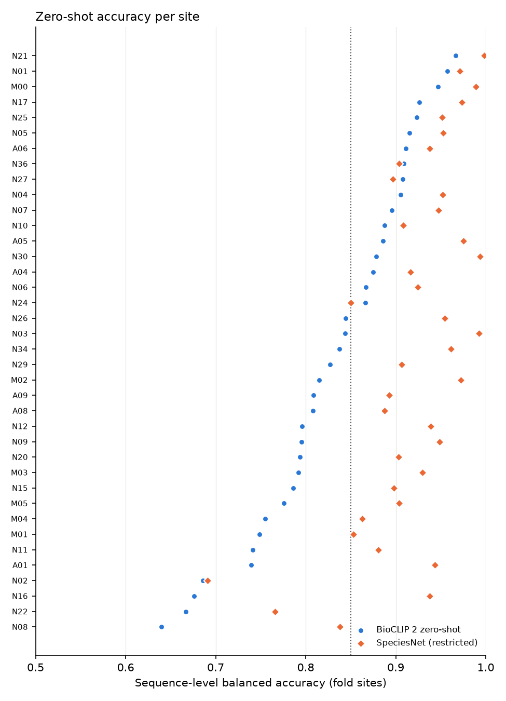
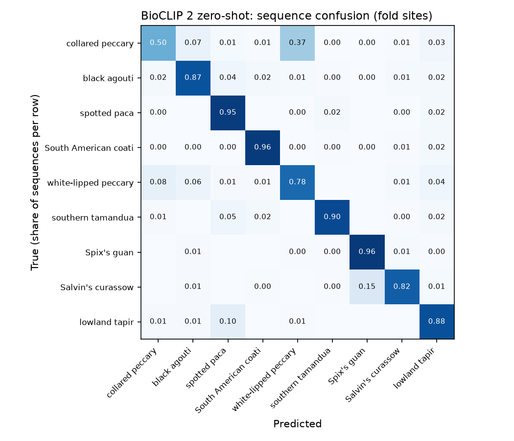

# Zero-shot baselines, the first spike and the detector

[Back to the README](../README.md)

Zero-shot baselines on every fold sequence: 38 sites, 7,590 sequences,
nine species, up to three crops per sequence with logits averaged
before softmax.

| Arm | Mean | Median | Worst site | Sites below 0.85 |
| --- | --- | --- | --- | --- |
| BioCLIP 2 zero-shot (champion) | 0.83 | 0.84 | 0.64 | 21 of 38 |
| SpeciesNet, restricted to the nine species | 0.92 | 0.93 | 0.69 | 3 of 38 |

Sequence-level balanced accuracy per site; sites with fewer than 20
sequences are left out.

- BioCLIP 2's main weakness is the two peccaries: it recalls only half
  of collared peccary sequences and calls 37% of them white-lipped
  peccary. Every other species is at 0.78 recall or above.
- SpeciesNet answers 90% of sequences in its own open-set mode, 91% of
  them correctly. It has probably seen these images (they went through
  Wildlife Insights), so none of its scores here are held-out
  performance.
- Small crops are rare but much harder: 695 of 20,991 frames have a
  long side under 224 px, and BioCLIP 2 gets about half of them right,
  against 72% of larger crops.

The first spike, on a capped sample of the same sites (5,337
sequences), gave two further pointers that the later studies test properly
(the [challengers](challengers.md) and the [drift study](drift-study.md)):

- A linear probe on BioCLIP 2's frozen embeddings averaged 0.89, +4.8
  points over zero-shot.
- Mean model confidence tracked per-site accuracy closely (Spearman
  0.87, 95% interval 0.73 to 0.93), a first hint that a label-free
  signal can flag weak sites.

On the spike sample BioCLIP 2 averaged 0.84 with 18 weak sites; the
full fold set adds the sequences the spike capped away (at most 100
per class per site) and gives 0.83 and 21.

The plan's rule for choosing the dataset, applied at the spike, asked
for at least a quarter of sites below 0.85 with the best zero-shot
model. Read against SpeciesNet that fails (3 of 38 sites); read against
BioCLIP 2 it passes. The
project uses the BioCLIP 2 reading because SpeciesNet's scores here are
not held-out, a choice made after seeing the results and recorded as
such.

Upstream, MegaDetector finds no animal at confidence 0.2 in 58 of 9,451
sequences (0.6%), which therefore reach no classifier. The misses
concentrate in lowland tapir (3.5% of its sequences) and spotted paca
(2.6%); the worst site, N02, loses 5.1%. A further 51 frames where the
detector also sees a person are dropped, costing 4 sequences their only
crops. Per-site and per-class tables are in `results/detector/`.
