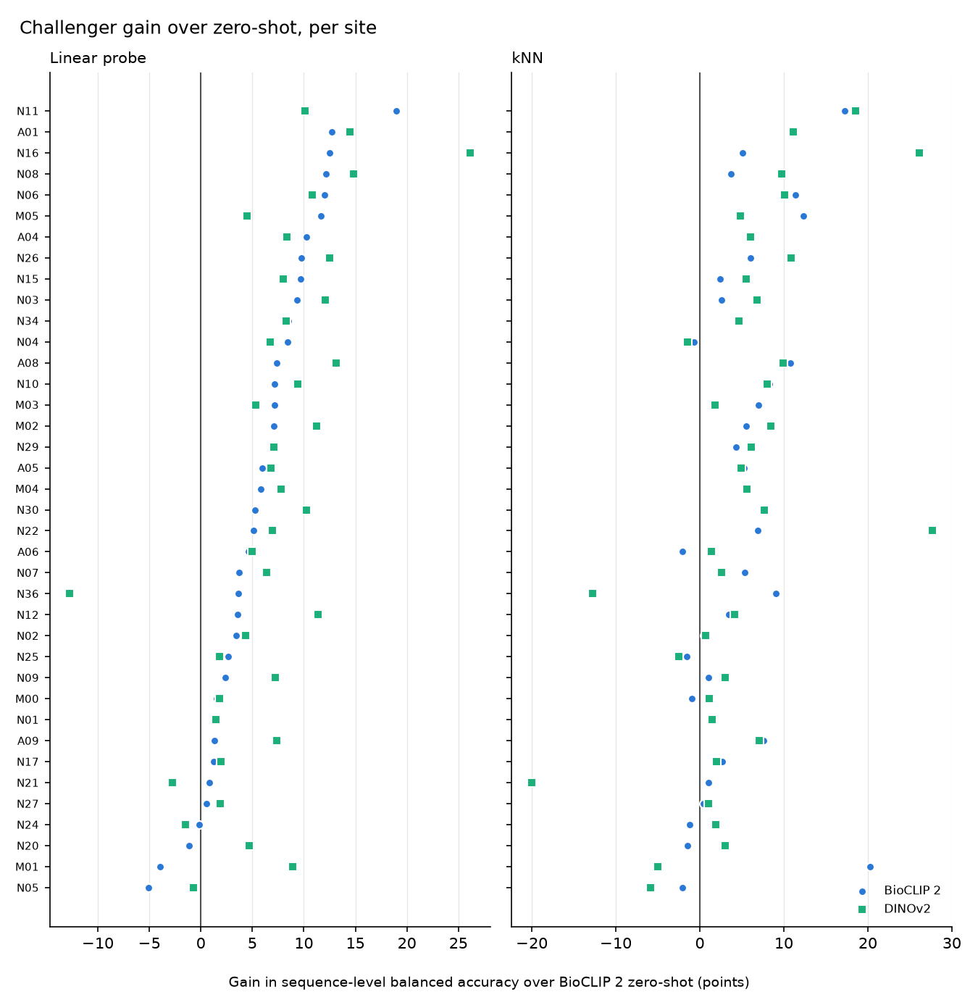
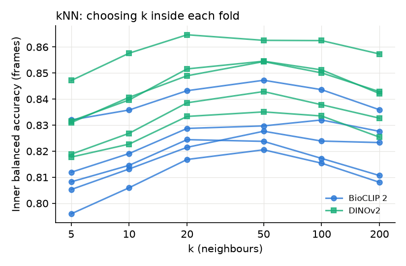
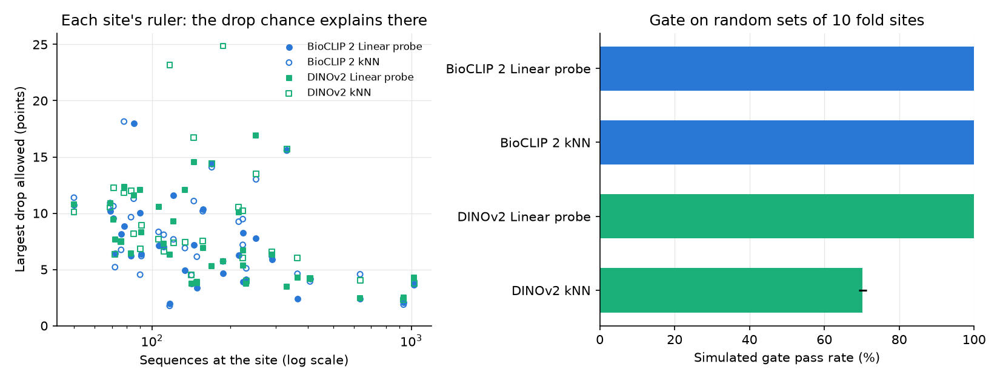

# Adapted challengers and choosing one for the hold-out

[Back to the README](../README.md)

Two cheap adaptations of each backbone's frozen crop embeddings, both
trained out of fold: every site is scored by a model built only from
the other folds' sites, with its one setting chosen inside those
training sites. Same frames, sequences and metric as the baselines
(`make challengers`; tables in `results/challengers/`).

- **Linear probe:** class-balanced logistic regression; regularisation
  strength C chosen by an inner site split.
- **kNN:** each crop takes the class-weighted vote of its k most similar
  labelled crops (cosine similarity). Votes are weighted by inverse class
  frequency, so the 2,710 collared peccary sequences cannot outvote the
  292 white-lipped on numbers alone, and half a vote is added to every
  class so confidence never reaches exactly 1.0. k is chosen by an inner
  site split from 5 to 200.

| Arm (38 fold sites) | Mean | Median | Worst site | Sites below 0.85 | Mean gain over BioCLIP 2 |
| --- | --- | --- | --- | --- | --- |
| BioCLIP 2 zero-shot (champion) | 0.83 | 0.84 | 0.64 | 21 | — |
| Probe on BioCLIP 2 | 0.89 | 0.91 | 0.71 | 10 | +5.6 points |
| Probe on DINOv2 | 0.90 | 0.92 | 0.73 | 10 | +6.9 points |
| kNN on BioCLIP 2 | 0.88 | 0.90 | 0.68 | 10 | +4.9 points |
| kNN on DINOv2 | 0.88 | 0.89 | 0.69 | 12 | +4.7 points |

- Every challenger improves at least 31 of 38 sites. These are
  fold-site scores, not the gate's decision, which is taken once on
  the sealed hold-out.
- The probes beat kNN on both backbones. kNN is also less even across
  sites: DINOv2's kNN loses 20 points at N21 (117 sequences), where
  zero-shot already scores 0.97, because it leans on whichever few
  training crops sit closest.
- The largest regressions are otherwise at small sites (the DINOv2
  probe loses 12.7 points at N36, which has 24 sequences). This is
  the per-site noise the gate has to allow for.
- DINOv2 was trained without species labels or text, yet its probe
  matches BioCLIP 2's. With a few thousand labelled sequences, the
  backbone's species knowledge matters less than the labels from these
  sites.

The first k grid stopped at 50, which won 8 of 10 inner splits, so the
best k could have lain beyond it. The grid was extended to 200 after
the fold scores had been seen, on the strength of the inner curves
alone, with the rule fixed beforehand that a win at 200 would be
reported as a lower bound rather than extended again. Every curve now
peaks inside the grid, mostly at 50, and the kNN scores moved by at
most 0.1 points.

## Choosing the hold-out challenger

Sending all four challengers to the hold-out and promoting whichever
passed would be four tries at one exam. So one is chosen first, on fold
sites only: the full gate is run on 2,000 random sets of ten fold sites
of hold-out size (at least 49 sequences, 33 sites), the same sets for
every challenger, and the challenger with the highest pass rate goes
forward, ties going to the larger mean gain.

| Challenger | Pass rate | Mean gain (points) | Worst site (points) |
|---|---|---|---|
| DINOv2 probe | 100% | +7.2 | −2.8 |
| BioCLIP 2 probe | 100% | +5.8 | −4.0 |
| BioCLIP 2 kNN | 100% | +5.1 | −2.1 |
| DINOv2 kNN | 70% | +4.9 | −20.0 |

- Three challengers pass every set, so the tie-break decides: the
  **DINOv2 probe** goes to the hold-out. Its lead is small but real:
  +1.4 points over the BioCLIP 2 probe, 95% BCa interval +0.1 to +2.8,
  paired by site.
- It was picked for scoring highest, so its fold-site gain flatters it
  (the winner's curse), so less was expected on the hold-out. It scored
  +9.7, with an interval that includes +7.2.
- Allowed drops (left) run from about 2 points at the largest sites to
  over 20 at a few mid-sized ones. Size alone does not set them: a site
  where the two models disagree often, or where a species has only one
  or two sequences, is noisier.
- DINOv2 kNN's 20-point loss at N21 is not flagged. Nearly all of it is
  one sequence: N21 has a single white-lipped peccary, worth a sixth of
  the site's balanced accuracy. kNN still fails 30% of sets, on the
  margin, because that site drags the lower bound down.
