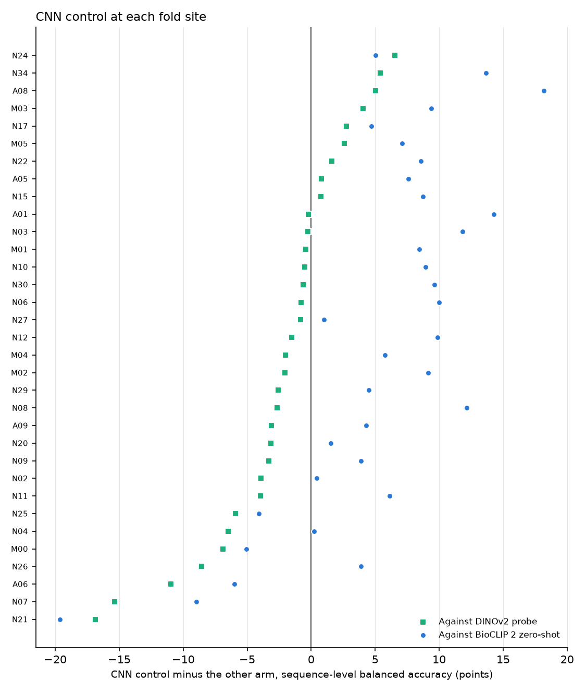

# The CNN control

[Back to the README](../README.md)

A control is an arm expected to lose, there to show what the frozen-embedding
route is beating. This one fine-tunes every layer of an ImageNet EfficientNet-B0
on the same crops and site folds as the probes, with the same class balancing,
so a loss cannot be blamed on the imbalance. The recipe (`arms/cnn.py`) has no
tuning step and was fixed before any fold was scored.

It is reported only. The hold-out is spent, so the control is scored out of
fold on the fold sites and never on a hold-out frame. It is logged as an MLflow
run with no model version, so no alias can point at it whatever its result. Two
limits apply to the comparison: the DINOv2 probe was selected on these same
sites, so its score is slightly optimistic, and one training seed leaves the
CNN's training noise unmeasured.

**Result:** the control lands between the two, closer to the probe. Scored out of fold on 7,590 sequences from 38 fold sites, its mean
site balanced accuracy is 88.5%, against 90.0% for the DINOv2 probe and 83.2% for
BioCLIP 2 zero-shot. The gate is run against both on the 33 sites with at least
49 sequences, as a reference only, since a control cannot be promoted:

| CNN control against | Mean gain (points) | 95% BCa interval | Sites ahead | Flagged drops | Gate |
| --- | --- | --- | --- | --- | --- |
| DINOv2 probe | −2.2 | −4.3 to −0.7 | 9 of 33 | A06, N25 | would fail |
| BioCLIP 2 zero-shot | +5.0 | +2.0 to +7.1 | 28 of 33 | none | would pass |

- Fine-tuning a whole network beats the zero-shot model, but a linear probe on
  frozen DINOv2 embeddings does better still, at a fraction of the cost: the
  probe trains in seconds, while the CNN took about 14 hours on CPU.
- Most of the CNN's loss is one confusion: it called 141 of 292 white-lipped
  peccary sequences collared peccary (recall 47%, against 72% for the probe).
  A06 and N25, the two flagged sites, are among those with the most
  white-lipped peccaries. The CNN does best on collared peccary itself (93%
  against 88%), so it learnt to favour the common one of the two.
- Per-site and per-class tables are in `results/control/`.
