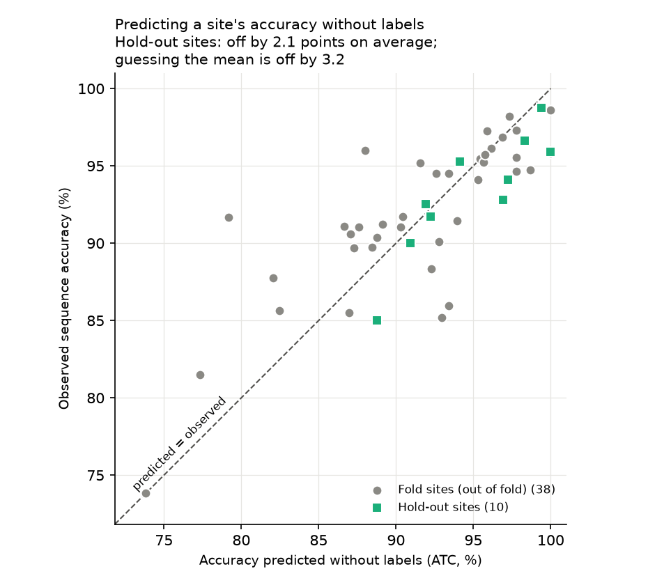
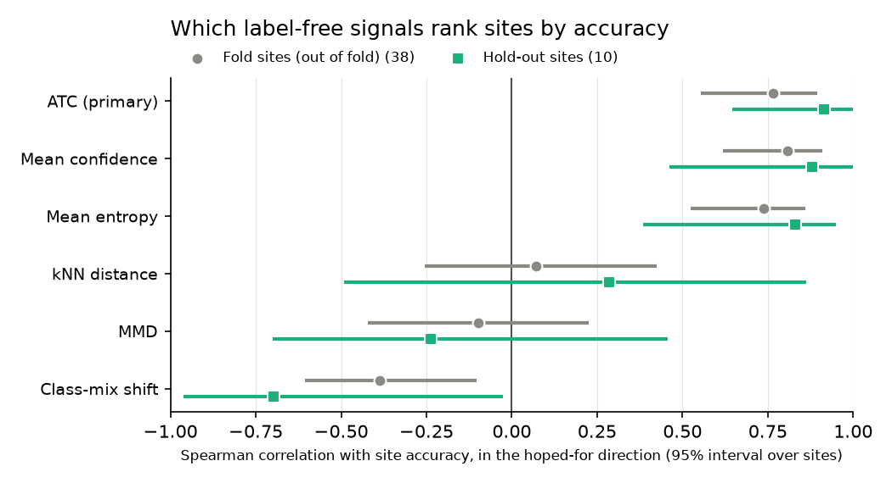

# The drift study

[Back to the README](../README.md)

Once a model is deployed at a new site there are no labels, so the question
is whether anything computable without them says how accurate it is there.
The drift study (`make drift`) replays every sequence through the champion in
site and date order, computes six label-free signals per site, and scores each
against the labels held back from it. The signals, the one named as primary,
the minimum sizes and the use of the hold-out were written into the plan
before any signal was computed.

Three signals come from the model's own probabilities: mean confidence (the
top class probability), mean entropy, and ATC
([Garg et al. 2022](https://arxiv.org/abs/2201.04234)), the primary. ATC
learns one confidence threshold on labelled sites, set so that the share of
sequences above it equals their accuracy, and predicts a new site's accuracy
as its share above that threshold. Two come from the embeddings: the distance
from a site's sequences to their nearest training sequences (kNN distance),
and MMD ([Gretton et al. 2012](https://jmlr.org/papers/v13/gretton12a.html)),
a measure of how differently two sets of vectors are distributed. The last is
how far the site's mix of predicted species is from the training mix. Nothing
a site is judged by was learnt from it: for a fold site the model, the
threshold and the training reference come from the other four folds; for a
hold-out site, from all fold sites, applied once.

- **Confidence ranks sites.** ATC's Spearman correlation with site accuracy
  is 0.76 over 38 fold sites (95% interval 0.55 to 0.89, resampling sites).
  On the 10 hold-out sites it is 0.92 (0.65 to 1.00), which agrees but rests
  on too few sites to add much. Mean confidence (0.81) and entropy (-0.74)
  do the same job.
- **As a predicted accuracy it is only slightly better than guessing the
  average.** On the hold-out sites ATC is off by 2.1 points on average, where
  giving every site the fold sites' mean accuracy is off by 3.2. The gain of
  1.1 points has an interval of -0.5 to +2.7, which includes zero, and the
  fold sites say the same (2.8 against 3.9; +1.1, -0.3 to +2.6). Sites here
  differ little (most score 85% to 99%), so the average is hard to beat. ATC
  also ran 1.7 points high on the hold-out.
- **Distance from the training images says nothing.** kNN distance (-0.07,
  interval -0.43 to 0.26) and MMD (+0.10, -0.23 to 0.42) show no relationship
  with accuracy. These are new sites in the same region, so the embeddings
  barely move; a new region might differ and is untested.
- **Class-mix shift points the wrong way.** Sites whose predicted species mix
  differs most from the training mix were more accurate, not less (+0.39,
  0.10 to 0.61). Unexplained; a site dominated by one easy species would do
  it, but that was not checked.
- **Over time, a fall in confidence goes with a fall in accuracy.** Each
  site's sequences were split into an early and a late half. Over the 34 fold
  sites with at least 20 sequences in each, the change in mean confidence
  correlates with the change in accuracy at 0.65 (0.33 to 0.87), and ATC at
  0.61 (0.25 to 0.88). Accuracy changes there spread 1.5 times wider than
  chance alone would give, so there was some real change to find. On the
  hold-out sites there was almost none (1.1 times), and the correlation is
  uninformative (ATC -0.25, interval -0.86 to 0.64).

In the figure each correlation is flipped where a higher signal should mean
lower accuracy (entropy, the two distances, class-mix shift), so a point to the
right of zero is a signal working as hoped; the numbers in the text are unflipped.

- **What it does not show.** Seven months at one study area: no season, no
  new region, no camera change. A straight line fitted from mean confidence to
  accuracy did a little better than ATC on the hold-out (off by 1.6 points;
  gain over the average +1.6, interval +0.2 to +3.1), but it was a secondary
  measure and is one of several, so it is not the headline. The fold sites
  are optimistic, because the probe was selected on them.
- Tables are in `results/drift/`: the replayed stream with per-sequence
  signals, per-site signals and predictions, and each signal's scores.
