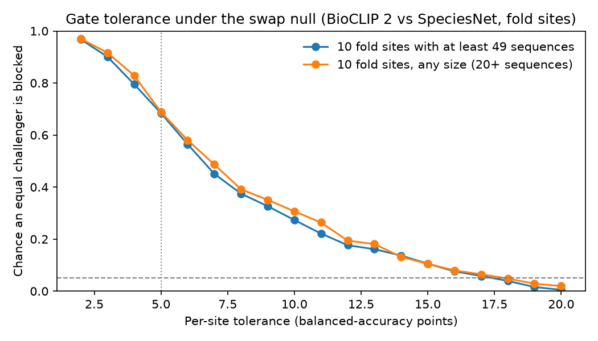

# The promotion gate's per-site check

[Back to the README](../README.md)

The gate promotes a challenger only if its mean per-site gain is above
zero, the lower 95% bound of that gain (BCa bootstrap over sites) is
above a margin of −1 point, and no single site drops by more than
chance explains there. A tie keeps the champion.

The plan started with a fixed per-site tolerance of 5 points. A swap
null showed why that fails: swapping the two models' predictions on a
random half of a site's sequences mimics a challenger exactly as good
as the champion, and with the real challengers a fixed tolerance had to
be 12 to 15 points before an equal challenger was blocked less than 5%
of the time across ten sites. That allowance is set by the noisiest
site, so it means nothing at a site with a thousand sequences.

So each site is judged against its own noise. The swap null gives the
site's drop a p-value, and the site blocks promotion if that p-value is
below 5% divided by the number of sites (a Bonferroni correction). The
chance of wrongly blocking an equal challenger stays at most 5% however
many sites a deployment has, and each site's allowance follows its own
size and how often the two models disagree there. The figure above is
the earlier stand-in calibration (BioCLIP 2 against SpeciesNet), kept
for the record; `make gate-calibrate` reproduces it.
