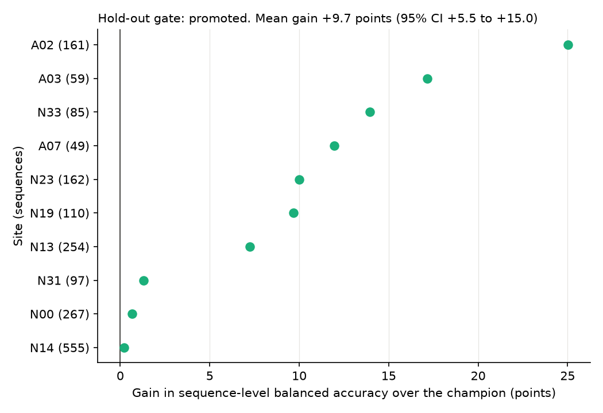

# The hold-out result and its freeze

[Back to the README](../README.md)

**On ten sites held out until the settings were frozen, a linear probe on
DINOv2 embeddings passed the promotion gate against BioCLIP 2 zero-shot.**
Its mean gain is +9.7 points of sequence-level balanced accuracy (95% BCa
interval +5.5 to +15.0), and it improved at all ten sites.

| Site mean, 10 hold-out sites | Balanced accuracy |
| --- | --- |
| BioCLIP 2 zero-shot | 0.836 |
| DINOv2 probe | 0.933 |

- The largest single improvement is collared peccary, BioCLIP 2's known
  weakness: pooled recall rises from 0.63 to 0.86 over 491 sequences. Lowland
  tapir falls from 0.95 to 0.90, which is one sequence of 20.
- The smallest gains are near zero: +0.2 at N14, +0.7 at N00, +1.3 at N31. No
  site dropped, so the per-site check had nothing to judge.
- The gain is above the fold sites' +7.2, not below as forecast, but the
  interval includes +7.2, so this is not evidence of a larger true gain.
  Looked at after the fact, the three hold-out sites named A gain +18.0 and the
  seven named N gain +6.2 (fold sites: +9.3 and +6.9). Three sites are too
  few to explain this.
- **What it does not show.** These are new sites in the same study region, so
  it says nothing about a new region. The probe needs labelled data from the
  region, where zero-shot needs none. The hold-out is now spent: anything later
  scored on it is reported for comparison and cannot be a fresh test.

## The hold-out freeze

[`config/holdout_freeze.json`](../config/holdout_freeze.json) is the
pre-registration record: it fixes everything the hold-out decision depends
on before the hold-out is scored. It holds the gate's settings, the ten
sites, the metric, the champion, the one challenger (DINOv2 probe), and how
that challenger is trained, down to the C grid and inner split. Freezing
only the challenger's name would leave its training open to adjustment after
seeing the result. It also records the hashes of the files it rests on (crop
index, published embeddings, selection results) and the numerical library
versions.

`make freeze` writes it once and refuses to overwrite it, and
`tests/test_holdout_freeze.py` pins its SHA-256, so any change to the file
or the data under it fails the tests and shows up in the git history.

The hold-out is one shot. Its result is reported whether the challenger
passes or fails, and a fail does not send another challenger in.

`make holdout-check` runs every check (freeze hash, inputs, recipe, library
versions, embeddings covering every frame) and stops before fitting or scoring
anything. `make holdout` then fits the challenger on every fold-site frame,
scores both arms on the ten sites, runs the gate and writes `results/holdout/`.
It refuses to overwrite a result; to reproduce one, pass another `--out-dir`
and compare. A rerun here (about 2 minutes) matched every output byte for byte.
