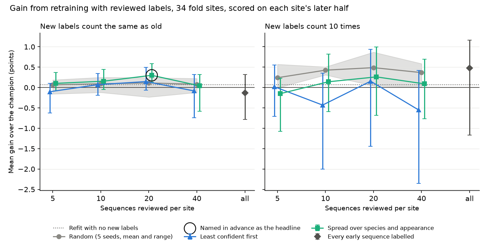

# The review loop

[Back to the README](../README.md)

When the drift study says a site may have slipped, the next step is to have a
person label some of its sequences and retrain. The review loop
(`make review`) simulates that and asks how many labels it takes, which
sequences are worth a reviewer's time, and whether the gate promotes the
retrained model. The sites, the split, the queues, the budgets and the one
headline comparison were written into the plan before anything was scored.

- **New sites.** The 39 fold sites, each new to a probe fitted on the other
  four folds. The ten hold-out sites repeat the exercise once; that hold-out
  is already spent, so it is a replication, never a fresh test.
- **Split by time.** A reviewer may label only from the first half of each
  site's sequences, in date order, and the retrained model is scored on the
  second half. A random split would flatter it: 36% of sequences follow a
  same-species sequence at the same camera within ten minutes.
- **Three queues**, each built from the champion's predictions alone, no
  labels: random (five seeds); least confident first; and one that takes
  turns across predicted species and, among a species' least confident
  sequences, picks the one least like anything already chosen.
- **Budgets** of 5, 10, 20 and 40 sequences per site, plus every early
  sequence as a ceiling. The reviewer is simulated from held-back labels and
  never errs. Retraining keeps the probe's recipe and adds the reviewed
  frames, either counted like any other frame or counted ten times.

Named in advance as the headline: the third queue at 20 sequences per site,
new labels counted once.

**The retrained model passed the gate, on a gain too small to matter.** With
680 reviewed sequences across 34 scored sites, mean balanced accuracy on the
later halves rose by 0.3 points (95% BCa interval +0.1 to +0.6): 23 of 3,751
sequences fixed and 5 broken. On the hold-out the same cell gained 0.5 points
(0.0 to +1.5) and also passed.

- **More labels did not help.** No budget, queue or weight gained more than
  0.9 points on the fold sites. Labelling every early sequence (3,734 of
  them) gave -0.1 points counted once and +0.5 (-1.2 to +1.2) counted ten
  times. The champion already scores 91.1 at these sites, which leaves little
  to recover.
- **No queue was shown to beat random.** The headline queue was 0.2 points
  ahead of random at 20 sequences (+0.0 to +0.4), which is one comparison of
  sixteen and was not repeated at other budgets or on the hold-out (+0.1,
  -0.1 to +0.4). Least confident first with labels counted ten times was
  0.9 points behind random at 40 sequences (-2.2 to +0.1).
- **The gate cannot see gains this small.** Refitting the probe with no new
  labels at all flips 12 sequences between right and wrong through numerical
  differences alone, comes out 0.07 points ahead, and passes. So do 44 of the 56 cells on the
  fold sites. The gate asks only that a challenger be better on average and
  not worse by a point, which was the right test for replacing a zero-shot
  model (+9.7 points) and is too weak for routine retraining. A minimum gain
  above this noise floor is the obvious repair; it is not applied here,
  because the gate was frozen before these results were seen.
- **What it does not show.** One linear probe, a perfect reviewer, one batch
  of labels with no second round, and seven months at one study area. A
  site with a species the training sites lack, or a model with more capacity
  to adapt, could behave differently. Upweighting fixed more sequences (87
  at 20 per site) and broke more (26).
- Tables are in `results/review/`: the first 40 of every queue, the gate's
  decision for every cell, per-site gains, each queue against random, and
  the headline cell's predictions. `make track` logs every cell as an MLflow
  run tagged with its decision; none moves an alias.
