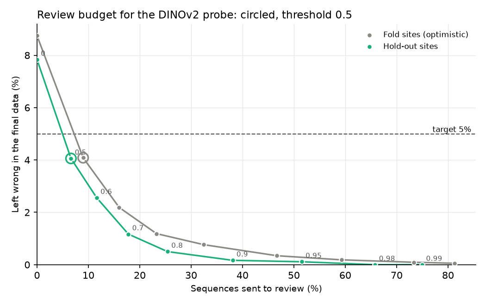

# The trust report

[Back to the README](../README.md)

The trust report (`make trust-report`, written to
`results/trust/trust_report.md`) is a per-site audit of the champion, the
DINOv2 probe, for someone deciding how far to trust its labels. It is
retrospective: it covers sites that have labels. Beside each site's observed
accuracy it shows the accuracy [the drift study](drift-study.md) predicts
without labels, which is all a new site would get. It covers all 49 sites:
the 39 fold sites, scored out of fold but optimistic because the probe was
chosen there, and the 10 hold-out sites, scored once by the frozen model. Its
rules were written into the plan before any of its numbers were computed.

**Review budget.** A sequence whose top class probability reaches a threshold
is accepted without review, and the rest go to a reviewer, who is assumed to
correct them. The suggested threshold is the lowest whose residual error (wrong
and unreviewed, over all sequences) is at most 5% on the fold sites, chosen
there only. That is 0.5, and on the hold-out sites it sends 6.6% of sequences to
review and leaves 4.1% wrong, against 7.8% with no review. A stricter 0.7 sends
17.8% to review and leaves 1.2% wrong. The probabilities come from a
class-balanced probe and are not calibrated, so the threshold is read off this
table rather than as "70% sure".

- **Regressions.** No site is worse than under BioCLIP 2 zero-shot (Holm over
  49 sites, alpha 0.05). Fourteen sites, three of them hold-out sites, are
  labelled "too little data to judge": the two models disagree on too few
  sequences there (nine or fewer) for any drop to be detectable, so they are
  unchecked, not passed, and belong with a specialist reviewer.
- **Weak species.** Eight site-species cells have recall below 70% with at
  least five sequences. Three are white-lipped peccary called collared peccary,
  the confusion that also sank the CNN control; N29 is the worst, at 42% of 43
  sequences.
- The per-site accuracy intervals resample sequences as if independent, which
  they are not at one site, so they are too narrow.
- Tables (per site, per site and species, per threshold) are in
  `results/trust/`.
